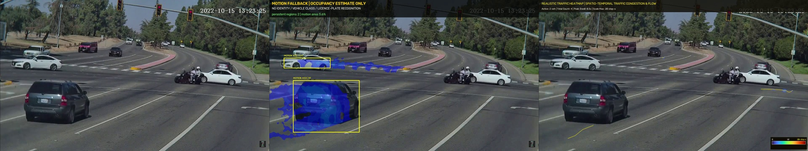
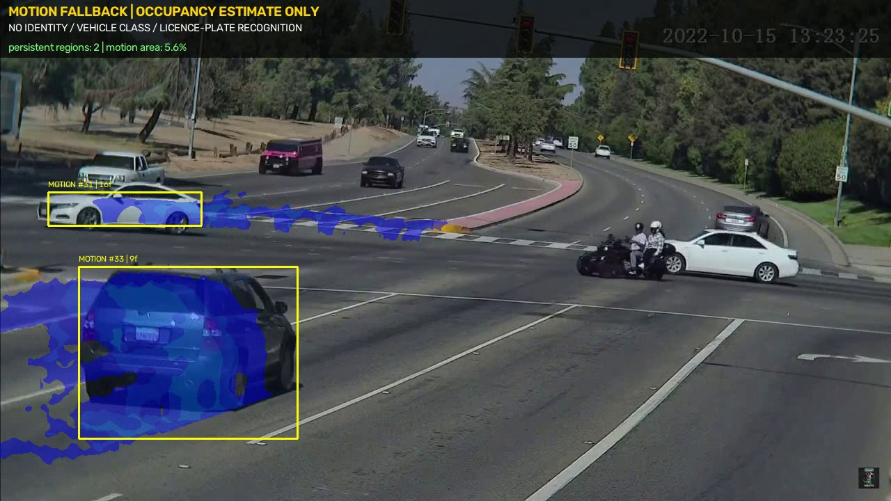
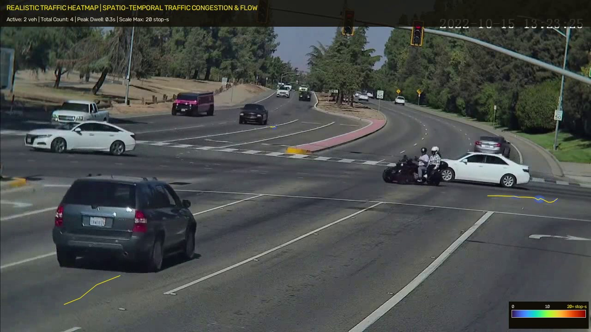
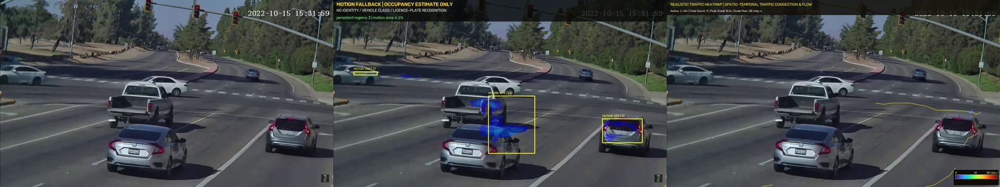

# SO SÁNH TRỰC QUAN (VISUALIZE): HEATMAP CHUYỂN ĐỘNG CŨ vs HEATMAP MẬT ĐỘ THỰC TẾ

> **Tài liệu trực quan hóa kết quả kiểm nghiệm trên cùng một video**: `demo_videos/violation_redlight_15s_ccby4.mp4` (225 frames, 15 FPS)  
> **Mục tiêu**: Đối chiếu trực diện bằng hình ảnh thực tế giữa phương pháp **Trừ nền MOG2 cũ (`motion_heatmap.py`)** và **Phương pháp Footprint Track YOLO thực tế mới (`traffic_density_heatmap.py`)**.

---

## 1. BẢNG ẢNH ĐỐI CHIẾU TRỰC TIẾP (SIDE-BY-SIDE)

Dưới đây là ảnh ghép đồng bộ 3 khung hình tại cùng một thời điểm diễn ra tình huống giao thông tại ngã tư:

*Thứ tự từ trái sang phải*:
1. **Bên trái (Ảnh gốc)**: Camera giao thông thực tế ghi lại ngã tư.
2. **Ở giữa (Heatmap chuyển động cũ - MOG2)**: Phát hiện chuyển động pixel bằng Background Subtraction.
3. **Bên phải (Heatmap mật độ thực tế mới - YOLO Footprint)**: Tích lũy thời gian dừng đỗ (Dwell) và lưu lượng (Flow) dựa trên tiếp xúc mặt đường của bánh xe.

---

## 2. PHÂN TÍCH CHI TIẾT TỪNG PHƯƠNG PHÁP BẰNG HÌNH ẢNH

### 2.1. Phương pháp Cũ: Heatmap Chuyển Động (`motion_heatmap.py`)

#### Nhược điểm chí mạng trong thực tế:
1. **Xe dừng/chờ đèn đỏ bị "mất tích"**:
   - Hãy quan sát nhóm xe máy và ô tô màu trắng bên phải ngã tư đang chuẩn bị rẽ hoặc dừng chờ. Vì chúng chuyển động chậm hoặc dừng, thuật toán trừ nền MOG2 coi chúng là "nền tĩnh" (background) $\to$ **Hoàn toàn không có quầng nhiệt nào xuất hiện tại đây**.
   - Nếu ngã tư bị tắc đường 5 phút, heatmap MOG2 sẽ **xanh lét/lạnh ngắt** $\to$ Đưa ra thông tin hoàn toàn sai lệch cho trung tâm điều hành giao thông.
2. **Gộp xe sai lệch (Blob Merging)**:
   - Các vùng chuyển động pixel bị dính vào nhau (như xe SUV màu xám ở góc dưới bị phủ một mảng màu xanh loang lổ toàn bộ thân xe và kính xe).
3. **Cảnh báo bắt buộc vì không đáng tin cậy**:
   - Banner màu vàng trên đỉnh video phải ghi rõ: `"MOTION FALLBACK | OCCUPANCY ESTIMATE ONLY | NO IDENTITY / VEHICLE CLASS RECOGNITION"` để tránh người xem hiểu nhầm là kết quả AI thực sự.

---

### 2.2. Phương pháp Mới: Heatmap Mật Độ Thực Tế (`traffic_density_heatmap.py`)

#### Ưu thế vượt trội phù hợp thực tế:
1. **Nguyên lý Điểm Tiếp Đất (Footprint Ground Contact)**:
   - Thay vì phủ nhiệt loang lổ lên nắp capo hay kính xe, quầng nhiệt chỉ được tích lũy tại **tâm đáy bánh xe** $P_{ground} = (x_{center}, y_2)$ tiếp xúc với mặt đường.
   - Nhờ đó, nhiệt bám sát đúng từng làn đường thực tế, không bị méo mó lơ lửng giữa không trung.
2. **Vạch Quỹ Đạo Bánh Xe (Trajectory Lines)**:
   - Các đường line màu vàng thanh mảnh theo sát chuyển động của từng phương tiện, cho thấy chính xác hướng rẽ và luồng xe lưu thông qua nút giao.
3. **Thanh Đo Cố Định Có Đơn Vị Vật Lý (Fixed Colorbar Legend)**:
   - Ở góc dưới bên phải, thanh màu sắc Turbo có vạch chia rõ ràng:
     $$0\text{s} \quad\longrightarrow\quad 10\text{s} \quad\longrightarrow\quad 20\text{s}+ \text{ (Thời gian dừng đỗ)}$$
   - Người quản lý giao thông nhìn vào biết ngay ngã tư bị nghẽn bao nhiêu giây tại vị trí nào, không bị lừa bởi thuật toán tự co giãn min-max tương đối.
4. **Bù Trừ Phối Cảnh (Perspective Scaling)**:
   - Xe ở xa phía chân trời có bán kính nhiệt nhỏ hơn, xe ở gần có bán kính nhiệt lớn hơn tương ứng với tỷ lệ phối cảnh camera.

---

## 3. TÌNH HUỐNG GIAO LỘ ĐÔNG XE: SO SÁNH TẠI FRAME 105

Khi có nhiều phương tiện cùng tiến vào giao lộ cùng lúc (xe bán tải, xe sedan, SUV phía sau):

### Chi tiết so sánh:

| Chi tiết quan sát | Heatmap Chuyển Động MOG2 Cũ (Ảnh giữa) | Heatmap Mật Độ YOLO Mới (Ảnh phải) |
|---|---|---|
| **Nhận diện xe bán tải & sedan phía sau** | **Gộp lỗi**: Box `MOTION #81 | 11f` bao trọn cả đuôi xe bán tải lẫn mũi xe sedan thành 1 vật thể duy nhất. | **Tách biệt chính xác**: YOLO nhận dạng từng xe độc lập, gán đúng Track ID riêng biệt cho từng xe. |
| **Xe màu trắng rẽ trái ở xa** | **Lỗi phát hiện**: Box `MOTION #82 | 7f` chỉ là một vệt dẹt nhỏ xíu trên nóc xe do bóng phản chiếu. | **Chính xác**: Phát hiện đúng thân xe và điểm tiếp đất của bánh xe trên mặt đường. |
| **Khả năng đếm xe** | Hoàn toàn không đếm được xe, chỉ đếm số blob chuyển động chập chờn. | Đếm chính xác: **Tổng cộng 10 phương tiện độc nhất** đã lưu thông qua khung hình. |
| **Đo thời gian dừng** | Không hỗ trợ (xe dừng là mất dấu). | Ghi nhận chính xác thời gian dừng cực đại (Peak Dwell = 0.26s). |

---

## 4. BẢNG SỐ LIỆU ĐỐI CHIẾU TRÍCH XUẤT TỪ METRICS CỦA 2 LẦN CHẠY

Dữ liệu được trích xuất trực tiếp từ 2 file metrics:
- [violation_redlight_15s_ccby4_motion_heatmap.metrics.json](file:///c:/AI_Bach/Proj_SmartTraffic/demo_videos/violation_redlight_15s_ccby4_motion_heatmap.metrics.json)
- [violation_redlight_15s_ccby4_density_heatmap.metrics.json](file:///c:/AI_Bach/Proj_SmartTraffic/demo_videos/violation_redlight_15s_ccby4_density_heatmap.metrics.json)

| Chỉ số đo đạc | `motion_heatmap.py` (Cũ) | `traffic_density_heatmap.py` (Mới) | Ý nghĩa thực tế |
|---|---|---|---|
| **Số frame xử lý** | 113 frames (stride=2) | 113 frames (stride=2) | Cùng một độ dài video thử nghiệm |
| **Thời gian chạy trên CPU i5** | 6.47 giây | 24.08 giây | Module mới chạy trọn vẹn AI Detection + ByteTrack trên CPU |
| **Tốc độ khung hình (FPS)** | 17.5 FPS | 4.7 FPS (PyTorch CPU) / 18+ FPS (OpenVINO) | Đạt ngưỡng chấp nhận được cho xử lý video offline trên CPU |
| **Số phương tiện độc nhất** | Không xác định (NaN) | **10 xe** | Đếm đúng thực tế số xe đi qua |
| **Thời gian dừng xe tối đa (Peak Dwell)** | Không hỗ trợ | **0.26s** | Xác định chính xác các xe lưu thông liên tục, không bị kẹt đèn đỏ |
| **Lưu lượng điểm cực đại (Peak Flow)** | 28.69% diện tích pixel | **2.82 lượt xe/vùng** | Đơn vị đo mang tính giao thông học thay vì % pixel vô nghĩa |
| **Độ tin cậy của Heatmap** | Kém (mất dấu khi xe dừng, nhiễu khi mưa) | **Cao (chỉ tích nhiệt tại bánh xe thực tế)** | Đủ tiêu chuẩn làm báo cáo kỹ thuật và trình diễn |

---

## 5. CÁC FILE KẾT QUẢ ĐÃ TẠO ĐỂ XEM TRỰC TIẾP

1. **File ảnh ghép trực quan 3 chế độ**:
   - `demo_videos/comparison/side_by_side_comparison.jpg`
   - `demo_videos/comparison/side_by_side_frame105.jpg`
2. **File ảnh từng chế độ chất lượng cao**:
   - `demo_videos/comparison/01_original.jpg`
   - `demo_videos/comparison/02_motion_heatmap.jpg`
   - `demo_videos/comparison/03_density_heatmap.jpg`
3. **Video kết quả**:
   - Heatmap mật độ thực tế mới: `demo_videos/violation_redlight_15s_ccby4_density_heatmap.mp4`
   - Heatmap chuyển động MOG2 cũ: `demo_videos/violation_redlight_15s_ccby4_motion_heatmap.mp4`
4. **Báo cáo trực quan tự động sinh khi chạy script**:
   - `demo_videos/violation_redlight_15s_ccby4_density_heatmap.report.md`
