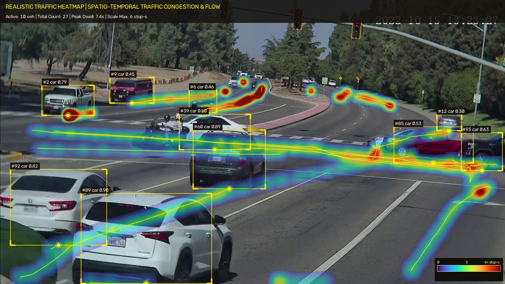
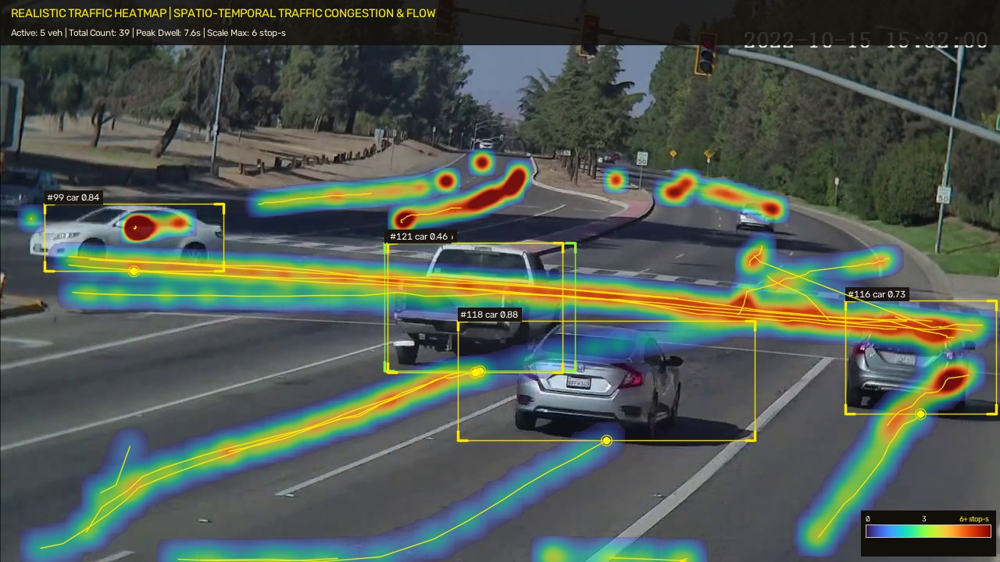

# Báo Cáo Trực Quan: Heatmap Mật Độ Giao Thông Thực Tế

> **Video nguồn**: `violation_redlight_15s_ccby4.mp4`  
> **Thời gian tạo**: `2026-10-17T09:42:19.636821+00:00`  
> **Chế độ Heatmap**: `COMBINED`

---

## 1. Hình Ảnh Trực Quan Kết Quả (Heatmap Snapshot)

### A. Khung Hình Thời Điểm Hoạt Động Cao Điểm (Peak Activity Snapshot)
*Thể hiện các phương tiện đang lưu thông kèm hộp nhận diện AI (Bounding Box), điểm tiếp xúc bánh xe (Footprint), và dải nhiệt làn đường:*

### B. Bản Đồ Nhiệt Tích Lũy Toàn Chu Kỳ (Cumulative Heatmap)
*Tích lũy toàn bộ vệt di chuyển và các điểm dừng chờ đèn đỏ suốt toàn bộ video:*

*Ghi chú trực quan*:
- **Hộp nhận diện (Bounding Box & Labels)**: Hộp viền màu vàng/xanh kèm mã định danh Track ID và độ tin cậy để chứng minh AI đang bám sát từng xe.
- **Điểm tiếp đất (Ground Footprint)**: Điểm tròn viền kép màu vàng định vị chính xác vị trí bánh xe tiếp xúc mặt đường (không bị lệch lên trần xe như tâm hình học).
- **Vệt nhiệt giao thông (Luminous Corridor)**: Thể hiện độ đậm nhạt tương ứng với tần suất xe lăn bánh qua làn và thời gian dừng chờ tại nút giao.
- **Thanh đo cố định (Colorbar ở góc phải)**: Đơn vị vật lý cố định (6s thời gian dừng hoặc 4 xe), không bị co giãn min-max ảo.

---

## 2. Thống Kê & Đo Đạc Giao Thông

| Chỉ số | Giá trị đo được | Ý nghĩa thực tế |
|---|---|---|
| **Tổng số phương tiện độc nhất** | **39 xe** | Số xe thực tế đi qua ngã tư (được khử trùng lặp qua Track ID) |
| **Thời gian dừng cực đại (Peak Dwell)** | **7.64 giây** | Điểm nghẽn ùn tắc nhất tại giao lộ (ví dụ: vạch dừng chờ đèn đỏ) |
| **Lưu lượng điểm cực đại (Peak Flow)** | **6.21 xe/vùng** | Mật độ xe tập trung cao nhất trên một làn đường |
| **Số khung hình xử lý** | **113 frames** | Độ dài chu kỳ quan sát |
| **Tốc độ xử lý thực tế** | **5.88 FPS** | Tốc độ tính toán trên CPU laptop (19.21s) |

---

## 3. Cấu Hình & Tối Ưu Hóa CPU

| Tham số | Giá trị | Giải thích |
|---|---|---|
| `imgsz` | `480` | Độ phân giải tối ưu cân bằng giữa phát hiện xe máy và duy trì FPS cao cho CPU |
| `conf` | `0.28` | Ngưỡng tin cậy cân bằng, chống dương tính giả do vệt mưa/bóng râm |
| `mode` | `combined` | Kết hợp cả thời gian dừng đỗ (Dwell) và lưu lượng dòng xe (Flow) |
| `max_dwell_scale_sec` | `6.0s` | Thang đo nhiệt tối đa cho thời gian xe dừng chờ |
| `max_flow_scale_count` | `3.5 xe` | Thang đo nhiệt tối đa cho lưu lượng xe qua làn |

---

## 4. Tệp Dữ Liệu Xuất Kèm

- **Video Heatmap đã render**: [violation_redlight_15s_ccby4_density_heatmap.mp4](file:///C:/AI_Bach/Proj_SmartTraffic/demo_videos/violation_redlight_15s_ccby4_density_heatmap.mp4)
- **Dữ liệu chi tiết từng frame (CSV)**: [violation_redlight_15s_ccby4_density_heatmap.metrics.csv](file:///C:/AI_Bach/Proj_SmartTraffic/demo_videos/violation_redlight_15s_ccby4_density_heatmap.metrics.csv)
- **Tóm tắt JSON**: [violation_redlight_15s_ccby4_density_heatmap.metrics.json](file:///C:/AI_Bach/Proj_SmartTraffic/demo_videos/violation_redlight_15s_ccby4_density_heatmap.metrics.json)
