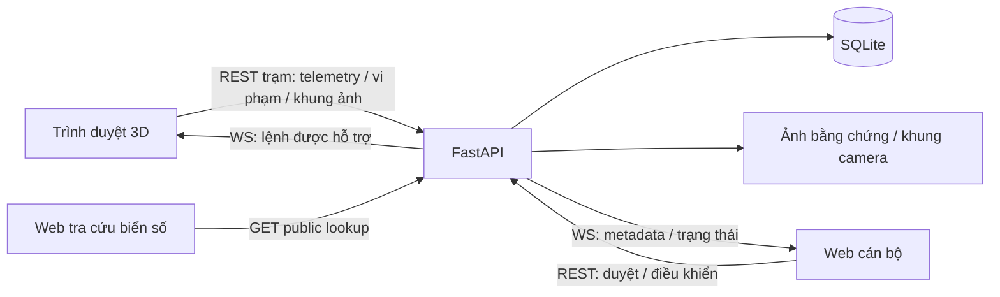

# Kiến trúc và bản đồ mã Smart Traffic

## Đích phát hành public v1

Ba trang chạy cùng origin Vercel. Tài nguyên tĩnh của cảnh Bắc và AI theo origin Pages ghim trên commit. Transport public giữ hồ sơ bằng IndexedDB và cập nhật nhiều tab qua BroadcastChannel. Một tab 3D giữ lease trạm, tính mô phỏng và gửi ack khi áp dụng lệnh. Browser tách inference từ ảnh trong worker khỏi dữ liệu mô phỏng dùng để điều phối đèn. [Hợp đồng và fixture](agent/CONTRACT-PUBLIC-DEMO.md) · [Runbook triển khai](deploy-public.md)

Các mục tiếp theo mô tả **hiện trạng local và Docker** được dùng làm đường cơ sở đối chiếu nghiệp vụ.

## Bắt đầu đọc

Đọc README để chạy hệ thống, sau đó theo ba entry dưới đây. Không cần đọc toàn bộ lịch sử City Lab để hiểu Smart Traffic.

| Phần | Entry và nơi thay đổi chính | Trách nhiệm |
|---|---|---|
| 3D | `outputs/hcmc-poc/webgpu-materials-24.html`, `webgpu-materials-24.js` | Tải dữ liệu/nền, tạo renderer, cảnh, vòng vẽ; `app=smart` chọn nhánh giao thông |
| Giao diện/ngữ cảnh Smart | `smart-app-32.js`, `kpi-panel-32.js`, `scene-context-32.js` | Lắp module Smart, HUD, URL/góc nhìn/khu Bắc, tiết kiệm tài nguyên |
| Web công dân | `outputs/smart-traffic/web/src/entries/citizen/App.tsx` | Tra cứu mặc định; `LookupPanel.tsx` gửi truy vấn; `AccountWorkspace.tsx` tải khi người dùng mở phần hồ sơ riêng |
| Web cán bộ | `outputs/smart-traffic/web/src/entries/officer/App.tsx` | Đăng nhập/vai trò, tab, KPI, WebSocket; tab riêng cho vi phạm, điều khiển, nhiệt, thống kê, nhật ký, cán bộ |
| API | `outputs/smart-traffic/backend/app/main.py` | FastAPI, lỗi chuẩn, auth, health và router |
| Lưu trữ | `app/db.py`, `app/models.py`, `app/config.py` | SQLite, schema/migration, cấu hình và đường dẫn runtime |
| Container | `compose.yaml`, `docker/` | Backend + nginx, build web, init DB, proxy API/WS, volume |

## Luồng hoạt động

Nginx chuyển tiếp API và WS trong Docker; không thay đổi nghiệp vụ. Trình duyệt 3D phải mở để sinh dữ liệu. SQLite là nguồn dữ liệu nghiệp vụ bền; heat/frames còn có bản mới nhất trong RAM và có dữ liệu lưu theo chính sách giữ.

## Module mô phỏng

| Vùng | Tệp chính trong `outputs/hcmc-poc/` |
|---|---|
| Mạng đường, hình học, renderer xe | `road-graph-31.js`, `city-traffic-sim-31.js`, `city-traffic-31.js` |
| Đèn/pha/bộ điều khiển | `signal-plan-32.js`, `traffic-controller-32.js`, `traffic-signals-32.js` |
| Camera và perception | `camera-capture-32.js`, `violation-perception-32.js`, `violation-rules-32.js` |
| Gửi backend và hàng đợi | `station-client-32.js`, `station-queue-32.js` |
| Bản đồ nhiệt và dự báo | `heat-*-32.js`, `forecast-*-32.js`, `data/heat-history-32.json` |
| Kịch bản/đồng hồ | `scenarios-32.js`, `clock-32.js` |
| Xe khẩn cấp | `emergency-32.js`: slot xe thật, model, ưu tiên cuốn chiếu, điểm nhường và cờ cần xem xét; nối qua sim/controller/station |
| Khu Bắc, giới hạn cảnh | `city-lock-32.js`, `city-region-31.js` |
| Tải tài nguyên theo vùng/LOD | `city-density-31.js` và các module City Lab còn được entry import |

Đèn tín hiệu Smart và cột đèn chiếu sáng là hai hệ khác chức năng. Bốn mặt đèn tại một nút có thể đại diện hai nhóm pha/hướng đối nhau; không xóa theo số lượng nhìn thấy. Bản hiện tại dùng lớp đồ nội thất đường 31; lớp runtime 28 đã tắt trước đợt này.

## API và ranh giới tin cậy

- `/api/v1/station/*`: tài khoản trạm đưa dữ kiện mô phỏng vào hệ thống. Backend tính lại penalty bằng `app/penalties.py`; không tin số tiền, nguồn hoặc verified từ trạm.
- `/api/v1/officer/*`: truy vấn/duyệt hồ sơ; lệnh điều khiển chỉ dành cho commander/admin. `priority-run` nhận loại ambulance/fire/police và phát lệnh tới trạm; trạng thái chạy thật/lỗi thiếu xe xem tại HUD 3D.
- `/api/v1/public/lookup`: tra cứu không cần tài khoản, chuẩn hóa biển số, chỉ trả hồ sơ ở trạng thái cho phép và các trường công khai.
- `/api/v1/citizen/*`: hồ sơ cá nhân, gắn biển, khiếu nại và ghi nhận đã nộp; tách khỏi đường tra cứu mặc định.
- `/api/v1/media/*`: tải ảnh/khung camera theo hợp đồng hiện tại.
- `/api/v1/health`: kiểm API và SQLite sẵn sàng.
- `/ws/v1`: token ở tin đầu, không ở URL. `stream.updated` chỉ có camera/seq; ảnh tải qua HTTP. Không thêm lại base64 vào broadcast.

`penalties.py` chuyển policy đã có của dự án sang phía server, không phải đợt rà soát luật mới. Policy cũ phía 3D chỉ phục vụ dữ liệu trạm/hiển thị; mức lưu chính thức của hồ sơ mới do backend quyết định. Hồ sơ lịch sử không được tự động sửa tiền trong đợt này.

## Dữ liệu và đường dẫn

- Chạy cục bộ: `outputs/smart-traffic/var/`.
- Docker: volume gắn `/app/var`, tách biệt DB cục bộ.
- SQLite: `smart-traffic.db`, gồm users, camera, seed, vi phạm, bằng chứng/metadata, khiếu nại, audit, thống kê và lệnh theo schema `models.py`.
- Ảnh/video: tệp bên ngoài SQLite; DB giữ quan hệ/metadata. Chưa chuyển media sang BLOB.
- `app/seed/`: dữ liệu mô phỏng khởi tạo, không được phục vụ toàn bộ thư mục công khai. Chỉ các JSON cấu hình mô phỏng được whitelist ở nginx.
- `web/public/north-roads-32.json`: nguồn đường cho bản đồ web và tên đường backend; cần có trong cả hai image.
- Lõi dùng chung `outputs/shared/digital-twin-core/` và các tệp `data/`, `assets/`, `vendor/` được entry 3D tham chiếu vẫn là dependency runtime dù tên chứa số phiên bản cũ.

## Khi thêm tính năng

Các công cụ trình diễn nằm trong ba tab của Smart HUD: **Vận hành**, **Đèn & dự báo**, **Thử nghiệm**. `test-lab-32.js` dời node DOM sẵn có, giữ nguyên listener. `signal-inspector-panel-32.js` chỉ hiển thị; `signal-preview-32.js` gom sáu mã HX thành năm giao lộ logic, nhóm nhánh gần song song và chạy bản sao controller trong 60 giây với xe/hàng chờ đóng băng. Nó không tua sim sống hoặc ghi dự báo vào SQLite. `vehicle-bounds-32.js` cung cấp phép scale khung bao; lớp vẽ tạo một InstancedMesh khi bật, giới hạn 400 xe trong góc nhìn, nằm ở helper layer nên không đi vào ảnh bằng chứng.

Đầu đèn lấy nhóm pha từ chính `net.arriveGroup`, đặt bên phải vạch dừng theo hình học làn, đỏ trên/vàng giữa/xanh dưới. Không còn bảng đếm billboard phóng tối thiểu 40 pixel. Hướng đỏ không hiện số đếm khi chưa có thời điểm xanh; lịch dự kiến nằm trong tab riêng. URL các module sửa trong đợt đèn dùng `v=32b` để loại bỏ cache cũ, kết hợp header revalidate của nginx.

NPC thử dùng slot an toàn chưa hoạt động trong pool, tối đa 50 xe/lượt và 200 slot thử. Dọn chỉ thu hồi slot thử, giữ xe khẩn cấp đang chạy. Reset/importState xóa danh sách sở hữu slot thử; dữ liệu nghiệp vụ SQLite vẫn được giữ.

Đổi nghiệp vụ ở backend và có test ranh giới; đổi mô phỏng ở module tương ứng và test Node; đổi UI ở entry/tab, rồi thử Browser. Đừng thêm điều khiển vào cả City Lab và Smart HUD. Tính năng điều khiển mới phải có khả năng thực thi ở trạm trước khi UI cho người dùng bấm chạy.
