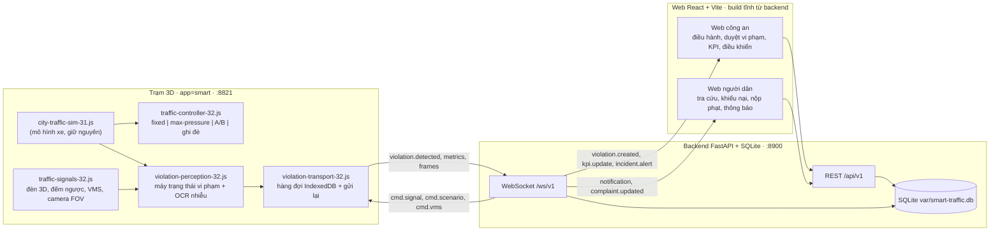

# Đặc tả thiết kế Smart Traffic khu Bắc

| Trường | Giá trị |
|---|---|
| Ngày | 2026-10-14 |
| Nhánh | `Kietvo2k/smart-traffic-bac` (worktree `smart-bac`) |
| Nguồn quyết định | `work/smart-decisions.md` (phỏng vấn 13–14/10/2026) — tài liệu này KHÔNG đổi quyết định |
| Mã tham chiếu | `outputs/hcmc-poc/` nhánh 31A (Three.js r186 WebGPU + WebGL2 fallback) |
| Loại tài liệu | Đặc tả thiết kế để nhiều agent làm song song; không chứa mã sản phẩm |
| Ngôn ngữ | Tiếng Việt có dấu, UTF-8 |

Quy ước đọc: **Bắt buộc** = không được làm khác; **Đề xuất** = giá trị mặc định, được chỉnh có ghi lý do;
**Cần xác minh** = chưa kiểm chứng đủ nguồn, không được coi là số liệu chốt.

---

## 1. Bối cảnh, mục tiêu, phạm vi

### 1.1 Bối cảnh

Đồ án/cuộc thi: demo giải pháp giao thông thông minh trên digital twin 3D Sài Gòn đã có
(`outputs/hcmc-poc/`, nhánh 31A, mô hình xe chạy trên `road-graph-31.json`, đèn giả lập
`SIGNAL_CYCLE = 44 s` trong `city-traffic-sim-31.js`). Nền tảng đã có: mạng đường + cầu,
xe bám IDM tất định (chạy được trong Node), 4 khu mô phỏng (`trung-tam`, `ven-song`, `bac`, `nam`),
chế độ Preview/Lite, Flood Lab 25A, bộ giảm mật độ.

### 1.2 Mục tiêu

1. Trở thành **Trung tâm điều hành giao thông khu Bắc** trên bản sao 3D: đèn thích ứng
   max-pressure, camera AI nhận diện vi phạm (mô phỏng có quy luật, không train model),
   vòng đời vi phạm khép kín từ hiện trường tới người dân tra cứu, khiếu nại, nộp phạt.
2. Đủ số liệu để so sánh A/B **đèn cố định ↔ đèn thông minh** bằng KPI đo được, tất định, cùng seed.
3. Chạy được trên máy demo chưa rõ cấu hình: mọi thành phần co giãn theo FPS.

### 1.3 Phạm vi

- Chỉ khu `bac` (Phía bắc · Thị Nghè · Bình Thạnh · Landmark 81, đa giác trong
  `city-region-31.js`). Ba khu còn lại **khóa tạm** (hiện biểu tượng khóa, không chọn được).
- Trạm 3D (`app=smart`), backend FastAPI + SQLite, web công an, web người dân.
- Lộ trình M1–M7 (mục 10).

### 1.4 Ngoài phạm vi

- Train model nhận diện thật; thanh toán thật; tích hợp cổng dịch vụ công/CSGT thật.
- Các khu `trung-tam`, `ven-song`, `nam` (khóa tạm, giữ nguyên cho QA 31A).
- Dữ liệu giao thông thật, camera thật, biển số thật của người thật (mọi dữ liệu sinh từ seed).
- Đổi mã 31A đang phát hành: mọi module mới là `*-32.js`, không sửa hành vi 31A khi không có `app=smart`.

---

## 2. Bảng quyết định (tóm từ `work/smart-decisions.md`)

| # | Quyết định đã chốt | Ghi chú kỹ thuật |
|---|---|---|
| Q1 | Chỉ làm khu `bac`; các khu khác khóa tạm | `setRegion(regionTrafficPayload('bac'))`; UI khóa 3 khu |
| Q2 | `index.html` chuyển hướng thêm `&app=smart` (và `?v=32a`); mở thẳng `webgpu-materials-24.html` không có `app` = 31A cổ điển y nguyên | Giữ QA 31 chạy được |
| Q3 | `app=smart`: nền xám tối giản khu ngoài bắc (đất + nước + đường chính mờ, viền ranh); cắt mesh theo khu | 31A đang gộp toàn cảnh → cần module cắt mesh 32 |
| Q4 | Nhà trong khu bắc: khối hộp trung tính không texture; bỏ nhà hẻm, giữ nhà trục chính; signature registry 100 % chi tiết | Landmark 81, Vinhomes CP, cầu Sài Gòn/Thị Nghè/Văn Thánh, Saigon Pearl, cao ốc Nguyễn Hữu Cảnh… |
| Q5 | Xe: giữ trục chính đủ đông để ùn; đường nhỏ thưa; **tắt/nới `BREAKER_S=50 s`** trong app=smart | Nó xóa kẹt thật |
| Q6 | Đèn 3D (cột, 3 màu, đếm ngược), biển báo, cột camera (FOV), VMS ở nhiều nút trọng điểm; nút nhỏ đèn cố định đơn giản | Xem Phụ lục A |
| Q7 | Đèn thích ứng max-pressure + công tắc A/B + KPI sống; hook là `green(node, st)` | Mục 4.1 và 6 |
| Q8 | Bản đồ nhiệt từ sim; dự báo kẹt bằng bản sao sim tua nhanh trong Web Worker; điều hướng xe thật rẽ tránh + VMS | M4 |
| Q9 | Đồng hồ tua nhiều nấc; lịch sử nhiều ngày dựng offline (sim headless) | M4 |
| Q10 | Kịch bản bấm-là-chạy: cao điểm, sự cố chặn làn, ngập Nguyễn Hữu Cảnh (Flood Lab 25A), xe ưu tiên | M5 |
| Q11 | Xe ưu tiên: làn sóng xanh; xe khác nhường → vi phạm gắn cờ "nghi nhường xe ưu tiên" để duyệt/gỡ | Mục 4.4 |
| Q12 | Perception mô phỏng có quy luật (không train); lỗi nhỏ trong12 loại; bằng chứng ảnh trước/sau + cắt biển số | Mục 7 |
| Q13 | Biển số VN + bộ sinh tất định từ seed + vài biển "kịch bản" (ghi trong seed, KHÔNG trên UI) | Mục 4.3 |
| Q14 | Stream: render-to-texture camera 3D, video thật `media/cameras/<MÃ-CAM>.mp4`, khe ONNX tùy chọn | Mục 4.5 (media) |
| Q15 | Backend FastAPI + SQLite, JWT, 4 vai trò, WebSocket; venv riêng, không cài global | Mục 4.5–4.7 |
| Q16 | Nguồn sự thật = tab 3D; mất kết nối → IndexedDB, gửi lại | Mục 5, 8 |
| Q17 | Web React + Vite, một project hai entry (công an, người dân); backend phục vụ bản build | Mục 3 |
| Q18 | Nộp phạt = chỉ đổi trạng thái, không thanh toán thật | `payments` chỉ ghi trạng thái |
| Q19 | Mức phạt theo NĐ 168/2024/NĐ-CP, có nguồn; chưa chắc thì ghi "cần xác minh" | Phụ lục B |
| Q20 | UI không được chứa chuỗi: "giả lập", "mô phỏng", "minh họa", "illustrative", "simulated", "demo", "fake" | QA quét DOM; chỉ tài liệu kỹ thuật/mã/README ghi bản chất |
| Q21 | Không logo/tên/tên miền CSGT, Bộ Công an, cổng dịch vụ công; dùng tên trung tính | "SaiGon SMTF · Trung tâm điều hành giao thông khu Bắc" |
| Q22 | Cổng: static `serve.py` PORT=8821, backend 8900, Vite dev 5173 | Agent song song tự đổi cổng |
| Q23 | Module mới `*-32.js`, khóa cache `?v=32a`; backend/web ở `outputs/smart-traffic/{backend,web,media,models,var}` | |
| Q24 | Kiểm thử: `node --test` (logic sim/điều khiển/luật), `pytest` (backend), Playwright/Chromium e2e | |
| Q25 | Server nền: `nohup … > file 2>&1 < /dev/null &`; tắt server/Chromium của mình khi xong | |

---

## 3. Kiến trúc tổng

### 3.1 Sơ đồ thành phần



**Nguyên tắc nguồn sự thật:** tab 3D sinh số đo, sự kiện vi phạm, ảnh bằng chứng, khung stream
(2–5 fps) và đẩy lên backend. Backend là nơi lưu giữ và phân phối; hai web chỉ hiển thị.
Mất kết nối: trạm xếp hàng `IndexedDB` và gửi lại (mục 8).

### 3.2 Cây thư mục dự kiến

```text
smart-bac/
├── outputs/
│   ├── hcmc-poc/                      # app 3D (31A giữ nguyên + module 32)
│   │   ├── index.html                 # SỬA: redirect thêm &app=smart&v=32a
│   │   ├── webgpu-materials-24.html   # SỬA (nối): đọc &app=smart, nạp module 32
│   │   ├── city-traffic-sim-31.js     # SỬA NHỎ: cắm controller + breakerS (mục 4.1)
│   │   ├── traffic-controller-32.js   # MỚI: hợp đồng đèn (fixed + max-pressure + A/B)
│   │   ├── traffic-signals-32.js      # MỚI: đèn 3D, đếm ngược, biển báo, cột camera, VMS
│   │   ├── violation-perception-32.js # MỚI: perception + luật vi phạm + OCR nhiễu
│   │   ├── violation-transport-32.js  # MỚI: hàng đợi IndexedDB, gửi backend
│   │   ├── city-region-mesh-32.js     # MỚI: cắt mesh đất/nước/đường theo khu (M2)
│   │   ├── smart-app-32.js            # MỚI: vỏ app=smart (khóa khu, ẩn panel, HUD KPI)
│   │   └── scripts/qa-smart-32.cjs    # MỚI: e2e Playwright (chuỗi cấm, FPS, tra cứu)
│   └── smart-traffic/
│       ├── backend/
│       │   ├── app/
│       │   │   ├── main.py            # FastAPI app + mount static build web
│       │   │   ├── config.py          # cổng, CORS, giới hạn upload, đường dẫn var/
│       │   │   ├── db.py              # SQLite (sqlite3/SQLAlchemy thuần, đơn giản)
│       │   │   ├── auth.py            # bcrypt + JWT
│       │   │   ├── models.py          # bảng (mục 4.7)
│       │   │   ├── schemas.py         # Pydantic khớp mục 4.4–4.6
│       │   │   ├── ws.py              # hub sự kiện theo vai trò
│       │   │   ├── routers/           # auth.py, station.py, officer.py, citizen.py, media.py
│       │   │   └── seed/              # accounts.json, plates.json, node_map.json, run_seed.py
│       │   ├── tests/                 # pytest (auth, violations, lookup, ws, media)
│       │   ├── requirements.txt       # fastapi, uvicorn, bcrypt, pyjwt, pydantic, (onnxruntime tùy chọn)
│       │   └── .venv/                 # venv riêng (không commit)
│       ├── web/
│       │   ├── package.json           # react, vite (không commit node_modules)
│       │   ├── vite.config.ts         # hai entry: police, citizen
│       │   └── src/
│       │       ├── entries/police/    # trang công an
│       │       ├── entries/citizen/   # trang người dân
│       │       ├── components/
│       │       └── lib/               # api.ts, ws.ts, format.ts
│       ├── media/cameras/             # <MÃ-CAM>.mp4, <MÃ-CAM>.labels.json
│       ├── models/                    # vehicle-detector.onnx (tùy chọn, không commit)
│       └── var/                       # jwt-secret.txt, smart-traffic.db, frames/, logs/ (không commit)
├── scripts/
│   ├── run-smart.ps1 / run-smart.sh   # chạy cả hệ (mục 3.3)
│   ├── kpi-ab-32.mjs                  # đo A/B headless trong Node
│   └── qa-smart-32.cjs                # e2e (nếu để chung với scripts/ hcmc-poc thì ghi rõ ở M1)
└── docs/superpowers/specs/2026-10-14-smart-traffic-bac-design.md   # tài liệu này
```

### 3.3 Cổng và cách chạy

| Thành phần | Cổng | Lệnh chạy |
|---|---|---|
| Static 3D (`serve.py`) | **8821** | `PORT=8821 python outputs/hcmc-poc/serve.py` → `http://127.0.0.1:8821/hcmc-poc/` |
| Backend FastAPI | **8900** | `outputs/smart-traffic/backend/.venv/Scripts/python -m uvicorn app.main:app --host 127.0.0.1 --port 8900` |
| Vite dev (web) | **5173** | `npm run dev` trong `outputs/smart-traffic/web` (khi dev; production: `npm run build` rồi backend phục vụ tĩnh) |

- URL app smart: `http://127.0.0.1:8821/hcmc-poc/index.html?app=smart&v=32a`
  (`index.html` chuyển hướng sang `webgpu-materials-24.html?...&app=smart&v=32a`).
- **`scripts/run-smart`** (bản `.ps1` cho Windows + `.sh` cho POSIX): kiểm tra Python/Node,
  khởi động ba tiến trình nền đúng thứ tự (static → backend → web), ghi log vào
  `outputs/smart-traffic/var/logs/*.log`, in URL ra stdout, có `run-smart --stop` để tắt.
  Mọi tiến trình nền chạy kiểu `nohup … > file 2>&1 < /dev/null &` (không để bash chờ vô hạn).
- Agent chạy song song: tự đổi cổng bằng biến môi trường `PORT`, `SMART_BACKEND_PORT`,
  `VITE_PORT`, không đụng cổng của agent khác.

---

## 4. Hợp đồng dữ liệu

Phần này là hợp đồng chung cho mọi agent. Tên trường JSON dùng `snake_case`; thời gian
dạng ISO-8601 UTC (`2026-10-14T09:30:00Z`); thời gian sim dùng số giây `t_sim`.

### 4.1 Bộ điều khiển đèn trong sim (thay `green()`)

**Chỗ thay (bắt buộc, chỉ một điểm):** `outputs/hcmc-poc/city-traffic-sim-31.js`

- Hàm `green(node, st)` hiện ở **dòng 480–484**:
  `t = (counters.t + signalOffset[node]) % SIGNAL_CYCLE; g = arriveGroup[st]; return g === 0 ? t < 22 : t >= 25 && t < 41;`
  → thay **thân hàm** bằng lời gọi `controller.isGreen(node, st, counters.t)`.
- Nơi duy nhất gọi `green()`: `tryAcquire()` **dòng 496** (`if (!ignorePriority && !green(node, st) && !sigHeld(i, plan)) return false;`) — giữ nguyên cách gọi.
- `createTrafficSim31(net, { centre, poolTarget })` (**dòng 347**) nhận thêm
  `{ controller = null, breakerS = BREAKER_S }`. `controller = null` → **giữ nguyên thân
  `green()` cũ** (`SIGNAL_CYCLE = 44 s`, xanh nhóm 0: 22 s, đỏ chung 3 s, xanh nhóm 1: 16 s,
  đỏ chung 3 s) để test 31A không vỡ. `mode: 'fixed'` của controller mới dùng chu kỳ **48 s**
  (mục 6.2) — hai cái là hai đường riêng, không trộn.
- **Bộ phá kẹt:** `BREAKER_S = 50` (**dòng 27**, dùng ở **dòng 764, 835**) → truyền tham số
  `breakerS`; `app=smart` gọi với `breakerS = Infinity` (Q5). 31A giữ 50 s.
- Pha/offset hiện tạo ở **dòng 224–238** (`signal[n]`, `signalOffset[n]`, `arriveGroup[st]`,
  gom cụm `SIGNAL_CLUSTER_M = 80 m`): controller MỌI chế độ phải tôn trọng cụm này —
  **đơn vị quyết định là cụm đèn**, không phải từng nút (xe xin khóa chuỗi nút kề cần xanh cùng lúc).
- API trả về của `createTrafficSim31` (**dòng 894–902**) thêm `controller`,
  `get signalGroups()`; `createTraffic31` (`city-traffic-31.js`) đưa ra
  `api.controller`, `api.signalState(nodeId)`, `api.setSignalMode(mode)`,
  `api.overridePhase(...)` bên cạnh các hàm sẵn có (`snapshot`, `stats`, `setRegion` dòng 331…).

**Giao diện (module `traffic-controller-32.js`, thuần JS, chạy được trong Node):**

```js
export const CONTROLLER_32_VERSION = 'controller-32a';
export const SIGNAL_PARAMS_32 = {
  yellowS: 3,        // Q7: vàng 3 s
  allRedS: 2,        // Q7: đỏ chung 2 s
  minGreenS: 8,      // xanh tối thiểu mỗi nhóm pha
  maxGreenS: 45,     // xanh tối đa mỗi nhóm pha
  decisionIntervalS: 1,   // cứ 1 s sau minGreen thì so áp lực
  switchMargin: 0.15,     // áp lực nhóm kia phải cao hơn 15 % mới đổi pha
  fixed: { green0S: 22, green1S: 16 },   // chế độ cố định: cùng pha vàng/đỏ chung
  clusterM: 80       // = SIGNAL_CLUSTER_M
};

export function createSignalController32({ net, sim, mode = 'fixed', params = {} }) -> controller
```

`controller` (đối tượng, không class) — **các phương thức bắt buộc:**

| Phương thức | Hợp đồng |
|---|---|
| `isGreen(node, st, tSim) -> boolean` | **Hàm sim gọi.** `node` = chỉ số nút (`net.G.nodes`), `st` = chỉ số trạng thái = cạnh có hướng (`lanes.st`), `tSim` = `counters.t`. Nhóm pha lấy `net.arriveGroup[st] ∈ {0,1}`. Nút không đèn (`!net.signal[node]`) luôn `true`. Đang ghi đè thủ công thì theo lệnh ghi đè. |
| `stateOf(node, tSim) -> SignalState` | Trạng thái cho UI 3D. `SignalState = {node_id, cluster_id, cycle_s, mode:'fixed'\|'smart', override: null\|{group, by, reason, until_t}, phases: [{group:0\|1, phase:'green'\|'yellow'\|'red', countdown_s}]}`. `countdown_s` là số giây còn lại của pha hiện tại của nhóm đó (đèn vàng/đỏ chung đếm ngược cùng nhau). |
| `update(tSim, queues)` | Sim gọi mỗi bước `STEP = 0,1 s`. `queues: Map<node, Array<{st, group, count, wait_sum_s, wait_max_s, speed_mean}>>` — hàng chờ theo nhóm pha (xe `v < 0,5 m/s` trước vạch, trong `Rz[node] + 20 m`). |
| `setMode(mode)`, `getMode()` | Chuyển A/B toàn hệ. Giữ nguyên `tSim`, không reset sim; đang giữa pha thì áp dụng từ lần đổi pha kế tiếp (trừ khi `setMode(mode, {immediate:true})`). |
| `overridePhase(node, group\|null, duration_s, by, reason)` | Ghi đè thủ công: `group ∈ {0,1}` giữ nhóm đó xanh tối đa `duration_s` (tối đa 120 s, tự hết hạn); `null` = hủy ghi đè đang có của nút. Mọi lệnh ghi đè đều sinh sự kiện `signal.override`. |
| `setParams(partial)`, `getParams()` | Sửa tham số lúc chạy (chỉ số, validate min < max). |
| `metrics(tSim) -> KpiSnapshot` | Xem mục 6.3. |
| `stateHash() -> string` | Hash trạng thái pha + override (8 hex) để test tất định. |

**Luồng tích hợp:** `smart-app-32.js` khởi tạo controller với `net` + `sim` rồi truyền vào
sim: hoặc ngay khi dựng `createTrafficSim31(net, { controller })`, hoặc sau đó bằng
`sim.attachController(controller)` (bọc cho cùng tham số; gọi được trước bước sim đầu tiên).
`traffic-signals-32.js` đọc `controller.stateOf()` mỗi khung để cập nhật đèn 3D và đếm ngược.
Test Node: `node --test` chỉ cần `buildTrafficNetwork31` + `createTrafficSim31` +
`createSignalController32`, không cần THREE.

### 4.2 Mã định danh

| Loại | Dạng | Ví dụ | Quy tắc |
|---|---|---|---|
| Nút giao | `<PREFIX>-<2 chữ số>` | `HX-01`, `NHC-03` | `PREFIX` theo cụm: `HX` Hàng Xanh, `DBL` Đinh Bộ Lĩnh, `NHC` Nguyễn Hữu Cảnh, `CSG` đầu cầu Sài Gòn, `PDL` Phan Đăng Lưu, `NBK` Nguyễn Bỉnh Khiêm, `VS` Văn Thánh, `TN` Thị Nghè. Bảng ánh xạ `node_id ↔ osm_node_id` lưu `backend/app/seed/node_map.json`, sinh từ Phụ lục A. M1 chỉ cấp `HX-01`…`HX-06`. |
| Camera | `CAM-<VÙNG>-<3 chữ số>` | `CAM-BT-001`, `CAM-HX-001` | `VÙNG ∈ {HX, BT, TN, NHC, CSG, PDL, NBK, VS}` (2–3 chữ in hoa). Tên file media **phải** trùng mã: `media/cameras/CAM-HX-001.mp4`, nhãn `media/cameras/CAM-HX-001.labels.json`. |
| Bảng VMS | `VMS-<VÙNG>-<2 chữ số>` | `VMS-HX-01` | |
| Vi phạm | `VP-YYYYMMDD-NNNNNN` | `VP-20261014-000123` | Số thứ tự tăng dần trong ngày, sinh ở backend. |
| Bằng chứng | `EV-<violation_id>-<kind>` | `EV-VP-20261014-000123-before` | `kind ∈ {before, after, plate_crop}`. |
| Xe (sim) | `V-<6 chữ số>` | `V-004231` | = `vehicle_index + 1` của sim (tất định theo seed). |
| Đoạn đường | `SEG-<road_index>-<dir>` | `SEG-1287-0` | Dùng cho bản đồ nhiệt/dự báo (M4). |
| Sự cố | `IC-YYYYMMDD-NNNN` | | M4–M5. |

**Mã lỗi (mã ngắn, ổn định API):** `RED-LIGHT`, `STOP-LINE`, `LANE`, `WRONG-WAY`, `SPEED`,
`PARK`, `NO-HELMET`, `NO-PRIORITY`, `OVERLOAD`, `WRONG-TURN`, `PHONE`, `NO-SEATBELT`.
Nhãn tiếng Việt hiển thị do web quyết định (bảng nhãn trong `schemas.py`, không hardcode rải rác).

**Loại xe:** khớp `TRAFFIC_KINDS` của sim — `motorbike`, `car`, `bus`, `truck`
(`city-traffic-sim-31.js` dòng 36–41). Thêm trường riêng cho xe ưu tiên:
`priority_kind ∈ {none, ambulance, fire, police}` (Q11).

### 4.3 Biển số, bộ sinh tất định, bảng xe/chủ xe

**Định dạng (regex kiểm ở backend, dùng lại ở web):**

- Ô tô: `^[0-9]{2}[A-Z][0-9]?-[0-9]{3}\.[0-9]{2}$` — ví dụ `51K-123.45`
- Xe máy: `^[0-9]{2}[A-Z][0-9] [0-9]{3}\.[0-9]{2}$` — ví dụ `59-X1 234.56`
- Tỉnh: ô tô `51` (TP.HCM), xe máy `59` (TP.HCM). Ký tự series: `A–Z` (bỏ `I`, `J`, `O`, `Q`
  theo lệ đặt biển — **cần xác minh** danh sách ký tự series thực tế; bản seed chỉ dùng tập con `A,B,C,D,E,F,G,H,K,L,M,N,P,R,S,T,U,V,W,X,Y,Z`).

**Bộ sinh tất định** (module `seed_plates` trong backend, bản JS song song
`violation-perception-32.js` phải cho cùng kết quả — test chéo):

```text
seed_plates = 31031                        # cùng SEED của sim (city-traffic-sim-31.js dòng 16)
r0 = hashU32(seed_plates ⊕ index)          # hashU32 đã export ở city-traffic-sim-31.js:52
r  = mulberry32(r0)                        # LCG chuẩn, 4 lần rút
plate = f(r, vehicle_class)                # như regex trên
color = COLORS[floor(r()*len(COLORS))]     # bảng 12 màu cố định
owner = OWNERS[floor(r()*len(OWNERS))]     # danh sách 200 tên Việt cố định trong seed/
phone = '09' + 8 chữ số sinh từ r()        # không phải số thật
```

- Cùng `(seed_plates, index, vehicle_class)` → cùng biển/xe/chủ, chạy lại bao nhiêu lần cũng vậy.
- Bảng xe/chủ: `backend/app/seed/plates.json` (sinh lúc `run_seed.py`, rồi ghi vào SQLite).
  Mỗi dòng: `{index, plate, vehicle_class, color, owner_name, owner_phone, is_scenario}`.
- **Biển kịch bản** (`is_scenario = 1`, tối đa 6 biển, ví dụ `51K-888.88`, `59-X9 999.99`):
  được ép sinh vi phạm ở các kịch bản demo. Danh sách này **chỉ nằm trong file seed**
  (`plates.json`, ghi rõ `is_scenario`), **không hiển thị trên bất kỳ UI nào** (Q13).

### 4.4 Bản ghi vi phạm (JSON schema), vòng đời, cờ xe ưu tiên

**Bản ghi vi phạm — JSON schema (đầy đủ trường, mức bắt buộc):**

```json
{
  "id": "VP-20261014-000123",
  "created_at": "2026-10-14T09:30:02Z",
  "updated_at": "2026-10-14T09:31:10Z",
  "violation_code": "RED-LIGHT",
  "violation_label": "Không chấp hành hiệu lệnh của đèn tín hiệu giao thông",
  "status": "new",
  "priority_flag": false,
  "priority_reason": null,

  "plate": "51K-123.45",
  "plate_format": "car",
  "vehicle_class": "car",
  "vehicle_color": "trắng",
  "vehicle_id": "V-004231",
  "owner_name": "Nguyễn Văn A",
  "owner_phone": "0901234567",
  "is_scenario_plate": false,

  "occurred_at": "2026-10-14T09:29:58Z",
  "node_id": "HX-01",
  "node_osm_id": 366390689,
  "node_label": "Cầu vượt Hàng Xanh ∩ Điện Biên Phủ",
  "camera_id": "CAM-HX-001",
  "road_index": 1287,
  "lane_index": 4,

  "signal": {
    "mode": "smart",
    "cluster_id": "HX-C1",
    "cycle_id": 1183,
    "phase_for_vehicle": "red",
    "group": 1,
    "elapsed_in_phase_s": 2.4,
    "cycle_s": 48.0,
    "speed_kmh": 38.5,
    "speed_limit_kmh": 50
  },

  "confidence": 0.82,
  "ocr_confidence": 0.91,
  "detection": {
    "in_fov_s": 3.2,
    "distance_m": 41.0,
    "grace_s": 0.8,
    "crossed_stop_line_at_s": 102.4
  },

  "evidence": [
    {"id": "EV-VP-20261014-000123-before", "kind": "before", "media_id": "MD-000451", "captured_at": "…", "width": 1280, "height": 720, "sha256": "…"},
    {"id": "EV-VP-20261014-000123-after", "kind": "after", "media_id": "MD-000452", "captured_at": "…", "width": 1280, "height": 720, "sha256": "…"},
    {"id": "EV-VP-20261014-000123-plate_crop", "kind": "plate_crop", "media_id": "MD-000453", "captured_at": "…", "width": 320, "height": 120, "sha256": "…"}
  ],

  "penalty": {
    "vnd_min": 18000000, "vnd_max": 20000000,
    "license_deduction_points": 4,
    "source": "NĐ 168/2024/NĐ-CP Điều 6 khoản 9 điểm b",
    "verified": true
  },

  "sim": {"t_sim": 102.4, "seed": 31031, "scenario": "peak-hang-xanh", "station_id": "STATION-3D-01"},
  "review": {"by": null, "at": null, "note": null},
  "complaint_ids": []
}
```

Trường **bắt buộc** khi tạo: `id, created_at, violation_code, status, plate, plate_format,
vehicle_class, occurred_at, node_id, camera_id, signal, confidence, evidence (≥ 1),
penalty, sim`. Trường nullable: `owner_*`, `priority_reason`, `review.*`, `complaint_ids`.
Ảnh `before`/`after` chụp từ camera 3D (render-to-texture) **trước và sau vạch dừng**;
`plate_crop` là ảnh cắt biển.

**Vòng đời trạng thái (`status`):**

```text
new ──(confidence ≥ 0.85 và không trùng)──► confirmed ──► notified ──► paid
 │                        │                                    │
 │                        │                                    └──► disputed ──► confirmed | dismissed
 ├──(confidence < 0.85 hoặc trùng lặp hoặc priority_flag)──► needs_review ──► confirmed | dismissed
 └──(phát hiện sai rõ ràng)──► dismissed
```

| Trạng thái | Nghĩa | Ai được đổi |
|---|---|---|
| `new` | Máy vừa tạo, chưa ai xem | hệ thống |
| `needs_review` | Cần công an xác minh (tin cậy thấp / trùng / cờ ưu tiên) | hệ thống → officer |
| `confirmed` | Đã xác nhận là vi phạm thật | officer, commander |
| `dismissed` | Đã gỡ (nhầm, nhường xe ưu tiên, chứng cứ yếu) | officer, commander |
| `notified` | Đã thông báo tới chủ tài khoản (nếu có) | hệ thống (khi `confirmed` và khớp tài khoản) |
| `paid` | Đã nộp phạt (chỉ đổi trạng thái, không thanh toán thật — Q18) | citizen (chính chủ), officer |
| `disputed` | Đang khiếu nại | citizen → officer xử lý |

Quy tắc chuyển: chỉ cho phép các cạnh vẽ ở sơ đồ; mọi thay đổi ghi `review` (ai, khi nào,
lý do) vào bảng `violations` + sự kiện `violation.updated`. Không cho nhảy thẳng
`new → paid`, `dismissed → paid`.

**Cờ xe ưu tiên (`priority_flag`):** khi có xe ưu tiên (`priority_kind ≠ none`) đang chạy
tuyến sóng xanh, mọi vi phạm sinh trong cửa sổ `[t_start − 5 s, t_end + 5 s]` trên các
đoạn/nút thuộc tuyến được gắn `priority_flag = true`, `priority_reason = "nghi nhường xe ưu tiên"`,
tự chuyển `needs_review` (không thông báo tự động). Officer duyệt: `dismissed` (nhường đúng)
hoặc `confirmed` (vi phạm thật). Người dân khiếu nại cũng về `disputed` xử lý như trên (Q11).

### 4.5 API REST backend

Base URL: `http://localhost:8900/api/v1`. Header: `Authorization: Bearer <JWT>` cho mọi
endpoint trừ `/auth/login` và `/public/*`. Vai trò trong JWT (`role`): `citizen`, `officer`,
`commander`, `admin`. Lỗi trả về thống nhất:
`{"error": {"code": "FORBIDDEN", "message": "…", "detail": null}}` với HTTP 400/401/403/404/409/413/422.

#### Auth

| Method | Path | Vai trò | Body / Response |
|---|---|---|---|
| POST | `/auth/login` | mọi người | Body `{"username":"officer1","password":"…"}` → `{"access_token":"…","token_type":"bearer","expires_in":28800,"role":"officer","display_name":"…"}` |
| POST | `/auth/logout` | mọi người | `{"ok":true}` (client xóa token) |
| GET | `/auth/me` | mọi người | `{"id","username","role","display_name","plates":["51K-123.45"]}` |

#### Trạm 3D (`role: station` — JWT riêng cấp cho tab 3D, `role = "station"`)

| Method | Path | Body / Response |
|---|---|---|
| POST | `/station/heartbeat` | `{"station_id":"STATION-3D-01","app_version":"32a","t":"…","uptime_s":1200,"fps":58.2,"webgpu":true}` → `{"ok":true,"server_time":"…","commands":[…]}` (poll dự phòng nếu WS rớt) |
| POST | `/station/metrics` | `{"station_id","t","fps","draw_calls","traffic":{"active","waiting_now","edge_transitions"},"kpi":{"wait_avg_s","queue_max","flow_per_min"},"signal_mode":"smart"}` → `{"ok":true}` |
| POST | `/station/violations` | Body = bản ghi vi phạm (mục 4.4, thiếu `id`/`created_at` do backend sinh) → `{"id":"VP-…","status":"new"}`; 409 nếu trùng `(vehicle_id, node_id, cycle_id, violation_code)` |
| POST | `/station/violations/{id}/evidence` | `multipart/form-data`: file ảnh + `{"kind":"before|after|plate_crop"}` → `{"media_id":"MD-…","sha256":"…"}` |
| POST | `/station/media` | `multipart/form-data` video/khung stream: tên file **phải** khớp `^(CAM-[A-Z]{2,3}-[0-9]{3})\.(mp4|jpg)$` → `{"media_id","camera_id"}`; 422 nếu sai mẫu tên |
| POST | `/station/frames` | `{"camera_id":"CAM-HX-001","seq":1024,"t":"…","jpeg_base64":"…","w":1280,"h":720}` → `{"ok":true}` (2–5 fps; backend giữ frame mới nhất/camera trong RAM + `var/frames/`) |

#### Công an (`officer`, `commander`, `admin`)

| Method | Path | Body / Response |
|---|---|---|
| GET | `/officer/violations` | Query `?status=new|needs_review|confirmed&code=&camera_id=&from=&to=&page=1&page_size=50` → `{"items":[bản ghi tóm tắt],"total","page"}` |
| GET | `/officer/violations/{id}` | Bản ghi đầy đủ + `evidence` + lịch sử `review` |
| POST | `/officer/violations/{id}/confirm` | `{"note":"…"}` → bản ghi `status=confirmed` |
| POST | `/officer/violations/{id}/dismiss` | `{"note":"nhường xe ưu tiên"}` → `status=dismissed` |
| POST | `/officer/violations/{id}/needs-review` | `{"note":"…"}` → `status=needs_review` |
| GET | `/officer/complaints` | Query `?status=open|resolved&page=` → danh sách khiếu nại |
| POST | `/officer/complaints/{id}/resolve` | `{"action":"confirm|dismiss","note":"…"}` → đổi trạng thái vi phạm gốc + đóng khiếu nại |
| GET | `/officer/kpi` | `?from=&to=&node_id=` → `{"wait_avg_s","queue_max","flow_per_min","mode","samples":[…]}` |
| GET | `/officer/streams` | `{"streams":[{"camera_id":"CAM-HX-001","fps":2,"url":"/api/v1/media/stream/CAM-HX-001","active":true}]}` |
| GET | `/officer/stats` | Thống kê theo lỗi/khu/ngày (M6) |

#### Chỉ `commander`/`admin` (điều khiển thủ công — Q16)

| Method | Path | Body / Response |
|---|---|---|
| POST | `/officer/controls/signal-mode` | `{"mode":"smart"}` → `{"ok":true,"mode"}` |
| POST | `/officer/controls/signal-override` | `{"node_id":"HX-01","group":0,"duration_s":60,"reason":"ưu tiên xe cứu thương"}` (`group:null` = hủy) → `{"ok":true,"until_t":…}` |
| POST | `/officer/controls/scenario` | `{"key":"peak|incident-block|flood-nhc|priority","params":{}}` → `{"ok":true,"scenario_id":"SC-…"}` |
| PUT | `/officer/vms/{vms_id}` | `{"lines":["Ùn tắc phía trước","Nên rẽ Bạch Đằng"],"ttl_s":600}` → `{"ok":true}` |
| GET | `/officer/controls/state` | Trạng thái A/B, override đang có, scenario đang chạy |

#### Người dân (`citizen`; tra cứu không cần đăng nhập)

| Method | Path | Body / Response |
|---|---|---|
| GET | `/public/lookup` | Query `?plate=51K-123.45&vehicle_class=car` → `{"items":[{"id","violation_code","violation_label","occurred_at","node_label","camera_id","status","penalty":{"vnd_min","vnd_max","verified"},"evidence":[{"kind","url"}]}],"total"}` — **không lộ** `owner_phone`, `is_scenario_plate`, `sim` |
| GET | `/public/incidents` | Cảnh báo kẹt công khai (M4): `{"items":[{"segment_id","level","prob","reliability","message","updated_at"}]}` |
| POST | `/citizen/account/register` | `{"username","password","full_name","phone","plates":["51K-123.45"],"vehicle_class":"car"}` → `{"ok":true}` (bcrypt) |
| GET | `/citizen/account` | Thông tin + danh sách biển đã đăng ký |
| GET | `/citizen/violations` | `?status=` — vi phạm của các biển của mình |
| POST | `/citizen/violations/{id}/pay` | `{"confirm":true}` → `{"status":"paid","note":"chỉ đổi trạng thái"}` — chỉ khi `status ∈ {notified, disputed}` và đúng chủ |
| POST | `/citizen/complaints` | `{"violation_id":"VP-…","message":"tôi đã nhường xe cứu thương","attachments":[media_id]}` → `{"id":"CB-…","status":"open"}` |
| GET | `/citizen/complaints/{id}` | Trạng thái khiếu nại + phản hồi |
| GET | `/citizen/notifications` | `?unread=true` → danh sách thông báo |
| POST | `/citizen/notifications/read` | `{"ids":[…]}` |

#### Media

| Method | Path | Response |
|---|---|---|
| GET | `/media/{media_id}` | Ảnh JPEG/PNG (cache `ETag`); công dân chỉ xem được bằng chứng của vi phạm `notified+` |
| GET | `/media/stream/{camera_id}` | Khung mới nhất (JPEG) hoặc MJPEG; query `?fps=2` |
| GET | `/media/video/{camera_id}` | `media/cameras/<CAM-ID>.mp4` nếu có file (Q14) |

### 4.6 Sự kiện WebSocket

Kết nối: `ws://localhost:8900/ws/v1?token=<JWT>&role=station|police|citizen`.
Mọi thông điệp: `{"event": "<tên>", "t": "<ISO>", "seq": 123, "data": {…}}`.
Không có `event` khớp danh sách → bỏ qua + log. Phía client tự nối lại (backoff 1→30 s).

**Trạm ↔ backend (chiều trạm → backend):**

| Event | Payload `data` |
|---|---|
| `station.heartbeat` | `{station_id, app_version, uptime_s, fps, webgpu}` |
| `station.metrics` | Giống `POST /station/metrics` |
| `station.frame` | `{camera_id, seq, t, jpeg_base64, w, h}` |
| `violation.detected` | `{violation: <bản ghi mục 4.4>, evidence_pending: ["before","after","plate_crop"]}` |
| `violation.evidence` | `{violation_id, kind, media_id, sha256}` |

**Backend → trạm:**

| Event | Payload `data` |
|---|---|
| `cmd.signal-mode` | `{mode: "fixed"\|"smart"}` |
| `cmd.signal-override` | `{node_id, group: 0\|1\|null, duration_s, by, reason}` |
| `cmd.scenario` | `{key, params, scenario_id}` |
| `cmd.vms` | `{vms_id, lines, ttl_s}` |
| `cmd.stream` | `{camera_id, on: true\|false, fps}` |
| `cmd.reload-seed` | `{reason}` (chỉ admin) |

**Backend → web (công an và người dân; server lọc theo vai trò):**

| Event | Payload `data` | Người nhận |
|---|---|---|
| `violation.created` | bản ghi tóm tắt | police |
| `violation.updated` | `{id, status, review}` | police, (citizen nếu là chủ) |
| `kpi.update` | `{t, wait_avg_s, queue_max, flow_per_min, mode}` | police |
| `signal.state` | `{node_id, phases, countdown_s, mode}` | police |
| `incident.alert` | `{segment_id, level, prob, reliability, message}` | police, citizen |
| `stream.frame` | `{camera_id, seq, jpeg_base64}` | police |
| `complaint.updated` | `{id, status, violation_id}` | police, citizen |
| `notification.created` | `{id, title, body, violation_id}` | citizen |

### 4.7 Bảng SQLite

File DB: `outputs/smart-traffic/var/smart-traffic.db` (WAL, `PRAGMA foreign_keys=ON`).
Khóa chính ghi `PK`; khóa ngoại `→ bảng.cột`. JSON nhúng lưu `TEXT` (chuỗi JSON).

| Bảng | Cột chính | Khóa |
|---|---|---|
| `users` | `id` PK, `username` UNIQUE, `password_hash` (bcrypt), `role` (`citizen\|officer\|commander\|admin\|station`), `display_name`, `created_at`, `active` | |
| `citizen_profiles` | `user_id` PK → `users.id`, `full_name`, `phone`, `email`, `created_at` | |
| `plates_seed` | `index` PK, `plate` UNIQUE, `vehicle_class`, `color`, `owner_name`, `owner_phone`, `is_scenario` | sinh từ seed (4.3) |
| `vehicles` | `id` PK, `plate` → `plates_seed.plate`, `vehicle_class`, `color`, `owner_name`, `priority_kind` DEFAULT `'none'`, `seed_index` | |
| `vehicle_ownerships` | `user_id` → `users.id`, `plate` → `plates_seed.plate`, `created_at` | PK `(user_id, plate)` |
| `violations` | `id` TEXT PK, `violation_code`, `status`, `plate`, `plate_format`, `vehicle_class`, `vehicle_color`, `owner_name`, `owner_phone`, `is_scenario_plate`, `occurred_at`, `node_id`, `node_osm_id`, `node_label`, `camera_id`, `road_index`, `lane_index`, `signal_json`, `confidence`, `ocr_confidence`, `detection_json`, `penalty_json`, `sim_json`, `priority_flag`, `priority_reason`, `review_json`, `reported_to_citizen`, `created_at`, `updated_at` | UNIQUE `(vehicle_id, node_id, cycle_id, violation_code)` lưu trong `sim_json.cycle_id` + cột `cycle_id` riêng để unique index |
| `evidence` | `id` TEXT PK, `violation_id` → `violations.id`, `kind`, `media_id` → `media_assets.id`, `captured_at`, `width`, `height`, `sha256` | |
| `media_assets` | `id` TEXT PK, `kind` (`image\|video\|frame`), `path`, `mime`, `bytes`, `sha256`, `camera_id`, `created_at` | |
| `complaints` | `id` TEXT PK, `violation_id` → `violations.id`, `user_id` → `users.id`, `message`, `status` (`open\|resolved\|rejected`), `resolution`, `created_at`, `resolved_at` | |
| `notifications` | `id` TEXT PK, `user_id` → `users.id`, `violation_id` → `violations.id`, `kind`, `title`, `body`, `read_at`, `created_at` | |
| `payments` | `id` TEXT PK, `violation_id` → `violations.id`, `amount_vnd`, `status` (`recorded\|reversed`), `created_at`, `by_user` → `users.id` | Chỉ ghi trạng thái (Q18) |
| `signal_nodes` | `node_id` TEXT PK, `osm_id`, `label`, `cluster_id`, `x`, `z`, `has_camera`, `has_vms`, `prefix` | từ `node_map.json` |
| `signal_state_log` | `id` PK, `node_id`, `cluster_id`, `t_sim`, `phase`, `group`, `mode`, `override_by`, `reason`, `created_at` | |
| `kpi_samples` | `id` PK, `t_sim`, `window_s`, `wait_avg_s`, `wait_p95_s`, `queue_max`, `queue_avg`, `flow_per_min`, `mode`, `scenario_key` | |
| `incidents` | `id` TEXT PK, `segment_id`, `level`, `prob`, `reliability`, `message`, `t_sim`, `created_at`, `cleared_at` | |
| `vms_messages` | `id` TEXT PK, `vms_id`, `lines_json`, `ttl_s`, `active`, `created_by` → `users.id`, `created_at` | |
| `station_metrics` | `id` PK, `station_id`, `t`, `payload_json`, `created_at` | |
| `scenario_runs` | `id` TEXT PK, `key`, `seed`, `mode`, `params_json`, `result_json`, `started_at`, `finished_at` | |

Index bắt buộc: `violations(status, occurred_at)`, `violations(plate, occurred_at)`,
`violations(camera_id, occurred_at)`, `kpi_samples(t_sim)`, `notifications(user_id, read_at)`.

---

## 5. Luồng dữ liệu M1 (xe vượt đỏ ở Hàng Xanh → người dân tra thấy)

1. **Hiện trường (sim).** Xe `V-004231` (`car`) đi trên `Điện Biên Phủ` tới nút `HX-01`
   (cầu vượt Hàng Xanh ∩ Điện Biên Phủ, osm 366390689) trong FOV `CAM-HX-001`.
   Controller (fixed hoặc smart) chuyển nhóm pha của xe sang **đỏ**.
2. **Vi phạm.** Sau ân hạn `grace_s = 0,8 s` kể từ khi đỏ, xe vẫn vượt vạch dừng
   (`s > s_stop_line`) → `violation-perception-32.js` đổi máy trạng thái
   `watch → grace → violation` (mục 7), sinh candidate `RED-LIGHT`.
3. **Bằng chứng.** Trạm chụp 2 khung render-to-texture từ `CAM-HX-001` (`before` trước vạch,
   `after` sau vạch) + ảnh cắt biển; OCR biển có nhiễu → `plate`, `ocr_confidence`;
   tính `confidence` tổng.
4. **Lên backend.** `violation.detected` qua WS (hoặc `POST /station/violations` khi WS rớt);
   nếu mất kết nối → xếp hàng `IndexedDB`, gửi lại (mục 8). Backend validate token `station`,
   kiểm trùng `(vehicle_id, node_id, cycle_id, code)`, ghi `violations` + `evidence` +
   `media_assets`, sinh `id = VP-YYYYMMDD-NNNNNN`.
5. **Phân loại.** `confidence ≥ 0,85` và không trùng → `new`; ngược lại → `needs_review`;
   nếu `priority_flag` → `needs_review` kèm lý do.
6. **Web công an.** Nhận `violation.created` → hiện đầu danh sách sống; officer
   xác nhận (`confirmed`) hoặc gỡ (`dismissed`). Khi `confirmed` và biển khớp tài khoản
   đã đăng ký → sinh `notifications` + đổi `status = notified`, phát
   `notification.created`.
7. **Người dân.** Mở "Tra cứu vi phạm giao thông", nhập biển `51K-123.45` + loại xe `car`
   → `GET /public/lookup` trả lỗi, thời gian, địa điểm (nhãn nút), ảnh, mức phạt,
   trạng thái. Nếu đã đăng nhập và đúng chủ → có nút khiếu nại/nộp phạt.
8. **Nộp phạt.** `POST /citizen/violations/{id}/pay` → `status = paid`, ghi `payments`
   (chỉ trạng thái). Khiếu nại → `disputed` → officer xử lý.

**Ngân sách thời gian (mục tiêu e2e < 10 s):** phát hiện ≤ 1 s + chụp/gửi ≤ 2 s +
ghi DB ≤ 1 s + WS push ≤ 1 s + API tra cứu ≤ 0,5 s → **≈ 5,5 s**, dự phòng tới 10 s
(kể cả khi tải trang). Kiểm bằng Playwright: đặt mốc `t0 = occurred_at`, đo lúc
bản ghi hiện trên UI tra cứu.

---

## 6. Đèn thích ứng max-pressure

### 6.1 Công thức áp lực

Với cụm đèn `C` (các nút cách nhau < `clusterM = 80 m`, chung pha — mục 4.1) và nhóm pha
`g ∈ {0,1}` (nhóm lấy từ `net.arriveGroup[st]`):

```text
P_g(C, t) = Σ_{st ∈ vào của g} q(st, t) − Σ_{st' ∈ ra tương thích với g} q_out(st', t)

q(st, t)     = số xe trên trạng thái st (cạnh có hướng) đang chờ hoặc chạy chậm trong
               phạm vi trước vạch: v < 0,5 m/s HOẶC còn cách vạch < 25 m
q_out(st',t) = số xe trên làn ra st' trong 25 m đầu (để không nhồi vào chỗ đầy)
```

Chọn nhóm có `P_g` lớn hơn tại mốc quyết định; nếu `|P_0 − P_1| / max(1, P_0 + P_1) < switchMargin`
thì giữ pha hiện tại (tránh dao động).

### 6.2 Chu kỳ quyết định, tham số mặc định

| Tham số | Mặc định | Ghi chú |
|---|---|---|
| `yellowS` | 3 s | Q7 |
| `allRedS` | 2 s | Q7 (đỏ chung hai đầu pha) |
| `minGreenS` | 8 s | mỗi nhóm pha |
| `maxGreenS` | 45 s | hết max bắt buộc nhường |
| `decisionIntervalS` | 1 s | chỉ so áp lực sau `minGreenS` |
| `switchMargin` | 0,15 | |
| `fixed.green0S / green1S` | 22 s / 16 s | giữ tỉ lệ xanh của 31A (`SIGNAL_CYCLE=44`) |
| Chu kỳ fixed | **48 s** | 22+3+2+16+3+2. **Khác** `SIGNAL_CYCLE=44 s` của 31A vì tách riêng vàng 3 s + đỏ chung 2 s theo Q7; hai chế độ dùng chung cấu trúc pha nên A/B chỉ khác cách phân bổ xanh |
| `breakerS` | `Infinity` trong app=smart | Q5; 31A giữ 50 s |

Thứ tự pha một chu kỳ: `g0 xanh → g0 vàng → đỏ chung → g1 xanh → g1 vàng → đỏ chung`.
Offset giữa các cụm: giữ `signalOffset` sinh từ seed như 31A (dòng 228) để so sánh được;
cùng cụm thì cùng offset.

### 6.3 KPI và cách đo

| KPI | Cách tính (tất định, từ sim) | Ghi |
|---|---|---|
| `wait_avg_s` | Trung bình tổng thời gian `v < 0,5 m/s` của các xe hoạt động, lấy mẫu mỗi 1 s rồi trung bình trong cửa sổ `window_s = 60` | Thời gian chờ TB |
| `wait_p95_s` | Bách phân vị 95 của thời gian chờ mỗi xe trong cửa sổ | |
| `queue_max` | Lớn nhất theo thời gian của `max_C Σ_st q(st,t)` (hàng chờ max tại một nút/cụm) | |
| `queue_avg` | Trung bình tổng hàng chờ mọi cụm đèn | |
| `flow_per_min` | `edgeTransitionsLast30s × 2` (biến `stats()` sẵn có, `city-traffic-sim-31.js` dòng 891) | Lưu lượng |
| `switches_per_hour` | Số lần đổi pha mỗi cụm / giờ sim | Chống dao động |

`controller.metrics(tSim)` trả `{window_s, wait_avg_s, wait_p95_s, queue_max, queue_avg,
flow_per_min, mode, overrides, by_node: [...]}`. Trạm đẩy lên backend qua
`station.metrics` 1 lần / 5 s; web công an hiển thị trực tiếp.

### 6.4 Đo A/B headless (cùng seed, cùng nhu cầu)

- Script `scripts/kpi-ab-32.mjs` chạy trong **Node** (không cần trình duyệt):
  `node scripts/kpi-ab-32.mjs --seed 31031 --scenario peak-hang-xanh --duration 600 --mode fixed|smart --out work/kpi-<mode>.json`
- Cố định: `SEED = 31031`, `STEP = 0,1 s`, `duration = 600 s` sim, `setRegion('bac')`,
  `setLightFactor(1.0)` (giờ vàng = cao điểm), `setDensity('full')`,
  kịch bản `peak-hang-xanh` (nhu cầu giờ cao điểm tại cụm Hàng Xanh).
- Chạy **hai lần** (fixed rồi smart) trên cùng seed, cùng thứ tự sinh xe → khác nhau
  duy nhất ở controller. Kết quả ghi `scenario_runs` + JSON để so sánh.
- Biên bản so sánh: `Δwait = (wait_avg_fixed − wait_avg_smart) / wait_avg_fixed`.

---

## 7. Perception và luật vi phạm vượt đỏ

### 7.1 Perception mô phỏng (không train model — Q12)

- Nguồn sự thật: trạng thái sim (`api.snapshot()`: lane, s, v, kind, active) + hình học
  `api.poses()` để chiếu ra hệ camera (vị trí, yaw, pitch, `fov_deg`, `range_m` của mỗi camera).
- Chu kỳ quét: mỗi `0,5 s` mỗi camera. Xe trong FOV và `distance_m ≤ range_m` →
  `detection {vehicle_id, kind, color, plate_read, plate_true, ocr_confidence, distance_m, in_fov_s}`.
- **Video thật:** nếu có `media/cameras/<CAM-ID>.mp4` thì phát trong ô stream; nếu có
  `models/vehicle-detector.onnx` thì chạy trên khung video để sinh detection
  (thay detection mô phỏng cho camera đó); không có file → dùng perception mô phỏng
  (đọc `media/cameras/<CAM-ID>.labels.json` nếu có, không thì sinh có quy luật).

### 7.2 Máy trạng thái theo xe × camera (luật `RED-LIGHT`)

```text
                    ┌──────────────────────────────────────────────┐
                    │                                              ▼
[watch] ── đèn nhóm xe = red và xe trong FOV ──► [grace] ── quá grace_s mà vẫn chưa qua vạch
   ▲                    │                          │                và sau đó vượt vạch
   │                    │ đèn xanh lại / xe rời FOV│                ▼
   │                    ▼                          │           [violation] ── tạo bản ghi + bằng chứng
   └──────────────────[idle] ◄─────────────────────┴── xe qua vạch trong grace ──► [idle]
```

- `GRACE_S = 0,8 s` ân hạn tính từ lúc đèn nhóm xe chuyển đỏ (xe đã quá vạch thì đi tiếp, không tính).
- Điều kiện chốt: `đèn đỏ` ∧ `xe vượt vạch dừng sau t_red + grace_s` ∧ `camera thấy`.
- **Chống trùng:** bỏ candidate nếu đã có bản ghi cùng `(vehicle_id, node_id, cycle_id, violation_code)`;
  `cycle_id` = số chu kỳ pha của cụm đèn tại `t_sim`.
- **Tỉ lệ xe phạm lỗi:** `violation_rate = 0,03` (**đề xuất**, đặt trong tham số seed).
  Xe được "chủ động vượt" nếu `hashU32(seed ⊕ vehicle_id ⊕ cycle_id) / 2^32 < violation_rate`
  — tất định, chạy lại không đổi. Các lỗi khác (M5) dùng cùng cơ chế sinh chủ động.

### 7.3 Các luật còn lại (mức M5, hợp đồng trước để thiết kế DB không phải đổi)

| Mã | Điều kiện phát hiện (từ sim) | Ghi |
|---|---|---|
| `STOP-LINE` | Dừng quá vạch khi đèn đỏ nhưng chưa qua hẳn nút | tách khỏi `RED-LIGHT` |
| `LANE` | Xe đổi làn/đè vạch liền: `lane` đổi tại đoạn vạch liền (thuộc tính đường `marking=solid`) | |
| `WRONG-WAY` | `lanes.dir` ngược chiều oneway hoặc đi vào cạnh `oneway='-1'` sai hướng | |
| `SPEED` | `v × 3,6 > speed_limit_kmh + 5` quá 2 s liên tục; `speed_limit` lấy `roads[i].maxspeed`, null → theo cấp: trunk 60, primary 50, secondary 40, tertiary/residential 30 km/h | |
| `PARK` | Dừng `> 30 s` ngoài vị trí cho phép (vỉa hè/cạnh nút/vạch) | |
| `NO-HELMET` | Xe máy có người lái không mũ (trạng thái sinh theo seed của xe) | |
| `NO-PRIORITY` | Không nhường xe ưu tiên: không tạt lề/vượt chậm khi xe ưu tiên trong 30 m | |
| `OVERLOAD` | Số người trên xe > quy định (trạng thái seed) | |
| `WRONG-TURN` | Rẽ/quay đầu tại cạnh có `turn=restricted` hoặc trong vùng cấm | |
| `PHONE` | Trạng thái seed của tài xế | |
| `NO-SEATBELT` | Trạng thái seed (chỉ `car`/`bus`) | |

### 7.4 Nhiễu OCR

- `plate_true` từ seed → `plate_read` bằng nhiễu có quy luật: mỗi ký tự có xác suất
  `p_swap = 0,06` bị đổi sang ký tự dễ nhầm (`0↔8`, `1↔7`, `5↔S`, `B↔8`, `D↔0`, `I↔1`),
  xác suất `p_miss = 0,02` mất 1 ký tự. `ocr_confidence = 0,98 − 0,12×(distance/range) − 0,25×(số ký tự bị đổi)`,
  kẹp về `[0, 1]`.
- Ngưỡng: `ocr_confidence < 0,75` → bản ghi `needs_review`; `confidence` tổng =
  `0,5×ocr + 0,3×(1 − distance/range) + 0,2×(in_fov_s ≥ 1)` và `confidence < 0,85` → `needs_review`.
- Seed cố định → nhiễu tất định, test được bằng `node --test`.

---

## 8. Xử lý lỗi

| Sự cố | Phát hiện | Xử lý | Người dùng thấy |
|---|---|---|---|
| Backend mất | WS đóng / POST lỗi mạng | Trạm xếp hàng `IndexedDB` (tối đa 2.000 bản ghi, FIFO, drop bản ghi cũ nhất có ghi log); retry backoff 1→30 s; heartbeat poll `/station/heartbeat` mang `commands` dự phòng | Web công an: banner "Mất kết nối máy chủ", dữ liệu mới nhất còn trong bộ nhớ; tự nối lại |
| Trạm 3D mất | `station.heartbeat` quá 15 s | Backend đánh dấu `station_id` `offline`, ngừng nhận `stream.frame` | Ô stream hiện "Không có tín hiệu", KPI giữ giá trị cuối + nhãn thời điểm |
| Thiếu video `media/cameras/<MÃ-CAM>.mp4` | Kiểm file lúc khởi động | Dùng render camera 3D + perception mô phỏng; `labels.json` nếu có | Ô stream vẫn chạy (ảnh 3D) |
| Thiếu `models/vehicle-detector.onnx` | Kiểm file lúc khởi động | Bỏ phân tích video thật; dùng perception mô phỏng | Không đổi gì trên UI |
| Thiếu model → vẫn có vi phạm | Perception mô phỏng luôn chạy từ sim | Không phụ thuộc ONNX | |
| FPS thấp (máy demo yếu) | `fps < 45` kéo dài 5 s | Bậc giảm: 1) stream 5→2→1 fps, 2) số ô stream 2→1→0, 3) tắt dự báo (Web Worker), 4) tắt bản đồ nhiệt, 5) hạ `density` (`balanced` → `light`); **không** tắt sim/đèn/vi phạm | HUD "Đã giảm tải hình ảnh để giữ mượt"; có nút bật lại |
| DB đầy / lỗi ghi | `sqlite3` lỗi, `var/` > 500 MB | Nén frame cũ (> 1 giờ), chặn nhận frame mới, cảnh báo trên UI admin | |
| Trùng lặp vi phạm | Unique index mục 4.7 | 409, bỏ qua không ghi log lỗi | |
| Token hết hạn | 401 | Trạm dùng refresh bằng `station` token riêng trong `var/`; web chuyển về đăng nhập | |

---

## 9. Kiểm thử và tiêu chí nghiệm thu M1

### 9.1 Kiểm thử

| Tầng | Công cụ | Vị trí | Nội dung chính |
|---|---|---|---|
| Logic sim/đèn/luật | `node --test` | `outputs/hcmc-poc/test/*.test.mjs` (hoặc `*.test.js`) | `isGreen` fixed khớp thời lượng 31A; max-pressure đổi pha đúng ngưỡng; `stateHash` tất định; máy trạng thái RED-LIGHT (grace, chống trùng); sinh biển số + OCR nhiễu tất định; KPI A/B chạy được |
| Backend | `pytest` | `outputs/smart-traffic/backend/tests/` | auth/role, tạo vi phạm + chống trùng, evidence, lookup không lộ thông tin chủ, khiếu nại, nộp phạt chỉ đổi trạng thái, media chặn sai tên file, WS phân vai trò |
| E2E | Playwright/Chromium kiểu `scripts/qa-*-31.cjs` | `outputs/hcmc-poc/scripts/qa-smart-32.cjs` | Mở `app=smart`, khóa khu, đèn 3D + đếm ngược, sinh vi phạm → tra cứu trên web người dân, quét chuỗi cấm trên cả 3 UI, đo FPS |
| A/B headless | `node scripts/kpi-ab-32.mjs` | mục 6.4 | KPI hai chế độ cùng seed |

### 9.2 Tiêu chí nghiệm thu M1 (đo được)

| # | Tiêu chí | Cách đo | Ngưỡng |
|---|---|---|---|
| A1 | Đèn thích ứng giảm thời gian chờ TB so với cố định | `kpi-ab-32.mjs`, kịch bản `peak-hang-xanh`, cùng seed 31031, 600 s | **X = 15 %** (đề xuất). **Cách chốt:** đo mốc đầu ở M1a — chạy 3 lần mỗi chế độ, lấy trung vị `Δwait`. `Δwait ≥ 15 %` → giữ X = 15 %. `8 % ≤ Δwait < 15 %` → đặt X = `Δwait − 2` điểm phần trăm (làm tròn xuống) và ghi số đo vào `scenario_runs.result_json`. `Δwait < 8 %` → **không tự sửa mục tiêu**, báo cáo lại về quyết định (mục 12.2). Sau khi chốt không sửa |
| A2 | 0 chuỗi cấm trên UI | `qa-smart-32.cjs` quét `textContent + aria-label + title` của `app=smart` và 2 web sau khi tải | 0 khớp với: `giả lập`, `mô phỏng`, `minh họa`, `illustrative`, `simulated`, `demo`, `fake` (không phân biệt hoa/thường) |
| A3 | FPS app smart ≥ 90 % FPS `region=bac` cổ điển | Cùng máy, cùng góc nhìn `region=bac`, mức **Cân bằng** (`density=balanced`), đo trung vị 30 s | `fps_smart / fps_31a ≥ 0,90` |
| A4 | E2E tra cứu thấy vi phạm | Playwright: đặt `t0` khi `violation.detected`, đo lúc bản ghi hiện ở web người dân | **< 10 s** |
| A5 | Vòng đời vi phạm đúng | pytest: đủ 7 trạng thái, chặn chuyển sai (mục 4.4) | 100 % case pass |
| A6 | Hai web + backend chạy được qua `run-smart` | Chạy `scripts/run-smart.ps1`, kiểm 3 cổng, đăng nhập bằng tài khoản seed | Cả 3 lên, không lỗi console mức error |
| A7 | Test tất định | Chạy `node --test` 2 lần liên tiếp | Cùng kết quả, `stateHash` trùng |

### 9.3 Ràng buộc trình bày (kiểm luôn ở M1 — Q20, Q21)

- UI của app smart + 2 web: **0 chuỗi cấm** (A2). Riêng tài liệu kỹ thuật/mã/README được ghi rõ bản chất mô phỏng.
- Tên hiển thị: "SaiGon SMTF · Trung tâm điều hành giao thông khu Bắc" (công an),
  "Tra cứu vi phạm giao thông" (người dân). Không logo/tên/tên miền CSGT, Bộ Công an, cổng dịch vụ công.

---

## 10. Phác thảo M2–M7

| Mốc | Mục tiêu | Thành phần chính | Tiêu chí nghiệm thu chính |
|---|---|---|---|
| **M2** Khu bắc gọn | Nền xám khu khác, khối nhà đơn giản, thưa đường nhỏ, tắt bộ phá kẹt, quét chữ cấm | `city-region-mesh-32.js` (cắt đất/nước/đường theo đa giác khu), `smart-app-32.js` (nhà hộp, bỏ nhà hẻm), `breakerS=Infinity` | 0 mesh nhà/cây/xe ngoài khu bắc; signature 100 %; A2 toàn khu; FPS ≥ A3; QA 31A chạy được khi không `app=smart` |
| **M3** Mạng nút + camera + VMS | Mạng đèn/camera/VMS toàn khu bắc theo Phụ lục A | `traffic-signals-32.js` mở rộng, seed `node_map.json`, `media/cameras/` | ≥ 12 nút có đèn 3D + đếm ngược; ≥ 8 camera có FOV; ≥ 4 VMS; đổi nội dung VMS qua API |
| **M4** Bản đồ nhiệt + dự báo + điều hướng + đồng hồ tua | Heatmap ribbon, dự báo Web Worker, xe rẽ tránh, tua giờ/ngày | `heat-32.js`, `forecast-worker-32.js`, lịch sử offline | Dự báo 10–30 phút có `prob + reliability`; xe giảm xác suất rẽ vào đoạn cảnh báo; tua giờ/phút/ngày không vỡ sim; lịch sử ≥ 1 ngày nạp được |
| **M5** Đủ lỗi + xe ưu tiên + 4 kịch bản | 12 loại lỗi (mục 7.3), sóng xanh ưu tiên, kịch bản bấm-là-chạy | mở rộng `violation-perception-32.js`, `scenario-32.js` | Mỗi loại lỗi sinh được + có bản ghi; 4 kịch bản chạy được (`peak`, `incident-block`, `flood-nhc`, `priority`); cờ ưu tiên → `needs_review` |
| **M6** Web đầy đủ | Khiếu nại, nộp phạt, tài khoản/thông báo, thống kê, phân quyền, điều khiển thủ công, VMS, video upload + khe ONNX, lưới stream co giãn | web police/citizen mở rộng, backend routers bổ sung | Đủ endpoint mục 4.5; phân quyền đúng vai trò; upload video + ONNX có/không có đều chạy; lưới stream 1→9 ô theo FPS |
| **M7** Nghiệm thu tổng + tài liệu | Chạy toàn bộ, đo lại A1–A7, hoàn thiện tài liệu | `run-smart`, QA tổng | Toàn bộ mục 9 pass trên máy demo; báo cáo KPI + ảnh nghiệm thu; README + runbook |

Sau M1: dòng 3D (M2→M3→M4→M5) và dòng web (M6) chạy song song, tối đa 2 agent (Q: mục 8 quyết định).

---

## 11. Bảo mật tối thiểu

| Hạng mục | Yêu cầu |
|---|---|
| Mật khẩu | bcrypt (rounds 12); không lưu plaintext ở bất kỳ đâu |
| JWT | Secret sinh ngẫu nhiên lúc chạy lần đầu, lưu `outputs/smart-traffic/var/jwt-secret.txt` (không commit `var/`); `HS256`, hạn 8 h, claim `role`, `sub` |
| CORS | Chỉ cho `http://localhost:8821`, `http://127.0.0.1:8821`, `http://localhost:5173`, `http://127.0.0.1:5173` (và cổng tùy biến nếu agent đổi cổng) |
| Upload | ≤ 50 MB/file; ≤ 200 request/phút/station; mime kiểm thật (magic bytes cho mp4/jpg/png) |
| Tên file video | **Phải** khớp `^(CAM-[A-Z]{2,3}-[0-9]{3})\.(mp4|jpg|png)$` — chính xác theo mã camera (có dấu gạch, ví dụ `CAM-HX-001.mp4`); chặn path traversal (`..`, `/`, `\`); 422 nếu sai |
| Phân quyền | Mọi endpoint kiểm `role`; citizen chỉ thấy vi phạm của biển mình đã đăng ký + tra cứu công khai không lộ `owner_phone`, `is_scenario_plate`, `sim` |
| Tài khoản seed dev | Nằm trong `backend/app/seed/accounts.json` (ghi rõ là seed dev); **không hiển thị trên UI**, không in ra console production; README ghi cách đổi |
| Bí mật khác | Không commit `var/`, `.venv/`, `node_modules/`, media/model lớn (Q23) |

---

## 12. Rủi ro và câu hỏi mở

### 12.1 Rủi ro

| # | Rủi ro | Ảnh hưởng | Giảm thiểu |
|---|---|---|---|
| R1 | `onnxruntime` có thể chưa có wheel cho Python 3.14 | Khe ONNX (M6) không chạy | Đặt là optional extra; thiếu thì dùng perception mô phỏng (hợp đồng mục 7.1 đã cho sẵn đường lùi); không chặn M1–M5 |
| R2 | Chi phí render-to-texture cho ảnh bằng chứng + stream | FPS tụt dưới A3 | M1 chỉ 2 camera; chụp 2 khung/vi phạm; tắt chụp khi `fps < 45`; frame stream 2 fps |
| R3 | Cắt mesh đất/nước/đường theo khu (31A đang gộp toàn cảnh) | M2 chậm; có thể phải dựng lại buffer | Module `city-region-mesh-32.js` riêng, không sửa module 31A; chuẩn bị phương án cắt theo bbox + đa giác, đo tam giác trước/sau |
| R4 | Bộ phá kẹt `BREAKER_S=50 s` che kẹt thật khi đo KPI | Số liệu A/B sai | `breakerS=Infinity` trong app=smart (đã là hợp đồng 4.1); test khẳng định không có `breakerRespawns` khi đo |
| R5 | Máy demo yếu (không rõ GPU) | Không đạt A3 | Chuẩn bị sẵn 3 mức `density`/`mode`; `run-smart --lite`; đo A3 trên máy demo sớm ở M1 |
| R6 | Max-pressure không thắng cố định ở kịch bản Hàng Xanh (cụm nút kề phức tạp) | A1 không đạt | Đảm bảo quyết định theo **cụm** (mục 6.2); chỉnh `switchMargin`, `minGreenS`; nếu vẫn không đạt thì ghi nhận trung thực theo A1 |
| R7 | Playwright/Chromium trên máy demo chưa biết | E2E chậm | QA script chạy headless, có chế độ chỉ kiểm DOM không chụp ảnh |
| R8 | Tồn đọng mã 31A có chuỗi cấm trong hằng số UI (ví dụ `BRIDGE_LABEL` ở `city-bridges-31.js:30`) | A2 fail | `app=smart` ẩn/ghi đè nhãn đó bằng module 32 (không sửa file 31A); QA quét sau khi app khởi động xong |
| R9 | Tên đường OSM không chuẩn (có chỗ `Ðiện Biên Phủ` thay `Điện Biên Phủ`) | Tra cứu/nhãn nút sai | Chuẩn hóa `Ð→Đ` khi so khớp (đã làm trong script Phụ lục A); hiển thị tên gốc như trong dữ liệu |

### 12.2 Câu hỏi mở

1. Máy demo: GPU/WebGPU hay chỉ WebGL2? Số màn hình? (chốt trước M2 để chọn mức stream)
2. M3 cần bao nhiêu camera toàn khu (ngân sách render-to-texture)? — đề xuất 8–12.
3. Có cần tách `commander` khỏi `officer` trong phân quyền API không, hay gộp vai trò khi demo?
4. Lịch sử nhiều ngày (M4): cần tối đa bao nhiêu ngày trong SQLite? — đề xuất 7 ngày, chu kỳ 5 phút.
5. Web người dân có cần đăng nhập để tra cứu không? (hiện: tra cứu công khai, đăng nhập để khiếu nại/nộp phạt/thông báo)
6. Tỉ lệ xe phạm lỗi 3 % (mục 7.2) — nên tăng lên 5 % cho demo sống động hơn? (chốt trước M5)

---

## 13. Phụ lục

### Phụ lục A — Ứng viên nút trọng điểm khu Bắc

Nguồn: `outputs/hcmc-poc/data/road-graph-31.json` (18.452 nút, 24.018 cạnh; `nodes[].id` = node OSM).
Script tra: **`work/tra-nut-trong-diem-31.py`** (chỉ để tra, không commit):
`PYTHONUTF8=1 python work/tra-nut-trong-diem-31.py --top 18`.

Quy tắc lọc: nút trong đa giác khu `bac` **+ margin 250 m** (cùng phép thử
`regionTrafficContains`, `city-region-31.js`) có ≥ 2 tên đường hoặc ≥ 3 nhánh; xếp theo
cấp đường (`trunk` 5 → `primary` 4 …) + số nhánh + tên đường ưu tiên theo quyết định
(ĐBP, XVNT, Đinh Bộ Lĩnh, Nguyễn Hữu Cảnh, cầu Sài Gòn, Phan Đăng Lưu, Lê Quang Định,
Nguyễn Bỉnh Khiêm…); cụm Hàng Xanh (bán kính 420 m quanh `x=0, z=−2485`) giữ tối đa 6 nút,
1 nút/cụm giao tên đường.

| # | node OSM | x | z | nhánh | cấp | tên đường giao | Hàng Xanh | Gợi ý mã |
|---|---|---|---|---|---|---|---|---|
| 1 | 366390689 | −251 | −2440 | 3 | trunk | Cầu vượt Hàng Xanh ∩ Điện Biên Phủ | ✔ | `HX-01` |
| 2 | 366440827 | 395 | −2427 | 3 | trunk | Nguyễn Gia Trí ∩ Điện Biên Phủ | ✔ | `HX-02` |
| 3 | 728690586 | 1331 | −2213 | 4 | primary | Cầu vượt Nguyễn Hữu Cảnh ∩ Nguyễn Hữu Cảnh ∩ Ung Văn Khiêm ∩ Điện Biên Phủ | | `NHC-01` |
| 4 | 10118771782 | −232 | −2657 | 4 | primary | Bạch Đằng ∩ Đinh Bộ Lĩnh | ✔ | `HX-03` |
| 5 | 12437015526 | −11 | −2634 | 4 | primary | Bạch Đằng ∩ Hẻm 328 Xô Viết Nghệ Tĩnh ∩ Xô Viết Nghệ Tĩnh | ✔ | `HX-04` |
| 6 | 701671562 | −242 | −2465 | 3 | primary | Đinh Bộ Lĩnh ∩ Điện Biên Phủ | ✔ | `HX-05` |
| 7 | 1497276515 | −14 | −2453 | 3 | primary | Ngã tư Hàng Xanh ∩ Xô Viết Nghệ Tĩnh | ✔ | `HX-06` |
| 8 | 1497313031 | 1358 | −2227 | 4 | primary | Nguyễn Hữu Cảnh ∩ Ung Văn Khiêm ∩ Điện Biên Phủ | | `NHC-02` |
| 9 | 2351201590 | −1414 | −2625 | 4 | primary | Bạch Đằng ∩ Lê Quang Định ∩ Phan Đăng Lưu | | `PDL-01` |
| 10 | 12980280176 | −1291 | −1461 | 4 | primary | Nguyễn Bỉnh Khiêm ∩ Ðiện Biên Phủ ∩ Điện Biên Phủ (2 cách đánh vần, xem ghi chú) | | `NBK-01` |
| 11 | 1497312813 | 1052 | −2076 | 4 | trunk | Nguyễn Hữu Cảnh ∩ Điện Biên Phủ | | `NHC-03` |
| 12 | 366390033 | −1162 | −1643 | 2 | trunk | Cầu Điện Biên Phủ 2 ∩ Điện Biên Phủ | | `TN-01` |
| 13 | 366448616 | 1213 | −2107 | 2 | trunk | Cầu Sài Gòn ∩ Điện Biên Phủ | | `CSG-01` |
| 14 | 676560165 | −1146 | −1633 | 2 | trunk | Cầu Điện Biên Phủ 1 ∩ Điện Biên Phủ | | `TN-02` |
| 15 | 2659114286 | 1164 | −2083 | 2 | trunk | Cầu Sài Gòn 2 ∩ Điện Biên Phủ | | `CSG-02` |
| 16 | 366423565 | −1407 | −2613 | 5 | primary | Bạch Đằng ∩ Phan Đăng Lưu ∩ Đường Bùi Hữu Nghĩa | | `PDL-02` |
| 17 | 9497980067 | 568 | −1142 | 4 | primary | Cầu Thủ Thiêm ∩ Nguyễn Hữu Cảnh ∩ Vòng xoay Nguyễn Hữu Cảnh | | `NHC-04` |
| 18 | 676561476 | −1339 | −1496 | 4 | primary | Nguyễn Bỉnh Khiêm ∩ Ðiện Biên Phủ | | `NBK-02` |

Ghi chú dữ liệu:

- Tọa độ hệ cảnh (m, `x` = đông, `z` = nam), gốc `CITY_DATA.meta.center`.
- OSM có nơi ghi `Ðiện Biên Phủ` (U+00D0) thay `Điện Biên Phủ` (U+0110) — chuẩn hóa khi so khớp (R9).
- Hàng 13, 15 là **đầu cầu Sài Gòn** (bậc 2, nằm trên trục ĐBP); hàng 12, 14 là hai đầu cầu Điện Biên Phủ.
- M1 chỉ cấp mã cho 6 nút Hàng Xanh (`HX-01`…`HX-06`); phần còn lại cấp dần ở M3.

### Phụ lục B — Mức phạt theo Nghị định 168/2024/NĐ-CP

Nguồn chính (truy cập 2026-10-14):

1. Toàn văn NĐ 168/2024/NĐ-CP: `https://xaydungchinhsach.chinhphu.vn/toan-van-nghi-dinh-168-2024-nd-cp-quy-dinh-xu-phat-vi-pham-hanh-chinh-ve-trat-tu-an-toan-giao-thong-duong-bo-119241231164556785.htm`
2. Công báo Chính phủ: `https://congbao.chinhphu.vn/van-ban/nghi-dinh-so-168-2024-nd-cp-43733/54013.htm`
3. Bộ Công an (tổng hợp mức phạt): `https://mps.gov.vn/chinh-sach-phap-luat/bai-viet/muc-xu-phat-vi-pham-hanh-chinh-ve-trat-tu-an-toan-giao-thong-duong-bo-tu-01012025-d1-t1624`
4. Bộ Công an (xe máy): `https://mps.gov.vn/chinh-sach-phap-luat/bai-viet/cac-muc-xu-phat-mot-so-loi-vi-pham-giao-thong-thuong-gap-doi-voi-nguoi-dieu-khien-xe-may-d1-t1650`
5. Vượt đèn đỏ/vàng: `https://thuvienphapluat.vn/chinh-sach-phap-luat-moi/vn/iThong/29283/vuot-den-vang-vuot-den-do-phat-bao-nhieu-tien`
6. Dùng điện thoại: `https://thuvienphapluat.vn/chinh-sach-phap-luat-moi/vn/ho-tro-phap-luat/chinh-sach-moi/77809/muc-phat-loi-su-dung-dien-thoai-khi-lai-xe-tu-ngay-01-01-2025`

Ngày hiệu lực: 01/01/2025 (thay NĐ 100/2019/NĐ-CP).

| Mã lỗi | Hành vi | Ô tô (Điều 6) | Xe máy (Điều 7) | Căn cứ / trạng thái |
|---|---|---|---|---|
| `RED-LIGHT` | Không chấp hành hiệu lệnh của đèn tín hiệu (vượt đèn đỏ/vàng) | 18.000.000–20.000.000 đ, trừ 4 điểm GPLX (gây TNGT: 20–22 triệu, trừ 10 điểm) | 4.000.000–6.000.000 đ, trừ 4 điểm (gây TNGT: 10–14 triệu, trừ 10 điểm) | Đ6 k9đ/b, k16; Đ7 k7c, k13 — **đã xác minh** (nguồn 3, 5) |
| `STOP-LINE` | Dừng quá vạch dừng / không chấp hành vạch kẻ đường | 4.000.000–6.000.000 đ (nhóm biển báo, vạch kẻ) | 400.000–600.000 đ (nhóm vạch kẻ) | **Cần xác minh** mức riêng cho "dừng quá vạch" |
| `LANE` | Đi không đúng phần đường/làn đường; chuyển làn sai | 4.000.000–6.000.000 đ, trừ 2 điểm; chuyển làn sai: 600.000–800.000 đ; gây TNGT 20–22 triệu, trừ 10 điểm | 400.000–600.000 đ | Đ6 k4a, k5b, k1a; Đ7 k3d — ô tô **đã xác minh**, xe máy **cần xác minh** mức |
| `WRONG-WAY` | Đi ngược chiều | 18.000.000–20.000.000 đ (đường thường); cao tốc 30–40 triệu | 4.000.000–6.000.000 đ | **đã xác minh** (nguồn 3, 4) |
| `SPEED` | Chạy quá tốc độ | Theo bậc % (0–5, 5–10, 10–20, >20 km/h) — **cần xác minh** từng bậc; gây TNGT 10–14 triệu | Theo bậc % — **cần xác minh**; gây TNGT 10–14 triệu | Nguồn 3 chỉ nêu mức gây TNGT |
| `PARK` | Dừng, đỗ xe trái quy định | 4.000.000–6.000.000 đ (gây ùn tắc); cao tốc 12–14 triệu | 400.000–600.000 đ | **đã xác minh** (nguồn 3, 4) |
| `NO-HELMET` | Không đội mũ bảo hiểm / không cài quai | — | 400.000–600.000 đ | **đã xác minh** (nguồn 4) |
| `NO-PRIORITY` | Không nhường đường / gây cản trở xe được quyền ưu tiên đang phát tín hiệu | **Cần xác minh** (thuộc nhóm Điều 6; nguồn chưa nêu con số) | **Cần xác minh** | Có hành vi trong văn bản (nguồn 1), chưa tra được mức |
| `OVERLOAD` | Chở quá số người quy định | Chở người trên buồng lái quá quy định: 600.000–800.000 đ | Chở 2 người: 400.000–600.000 đ; từ 3 người: 600.000–800.000 đ | **đã xác minh** (nguồn 3, 4) |
| `WRONG-TURN` | Quay đầu/rẽ nơi cấm, trái quy định | 4.000.000–6.000.000 đ (gây ùn tắc); gây TNGT 10–14 triệu | **Cần xác minh** mức riêng | Một phần **đã xác minh** (nguồn 3) |
| `PHONE` | Dùng tay cầm và sử dụng điện thoại khi lái | 4.000.000–6.000.000 đ | 800.000–1.000.000 đ, trừ 4 điểm (gây TNGT: 10–14 triệu, trừ 10 điểm) | **đã xác minh** (nguồn 3, 6) |
| `NO-SEATBELT` | Không thắt dây đai an toàn | 800.000–1.000.000 đ | — | **đã xác minh** (nguồn 3) |

Quy tắc dùng trong sản phẩm: chỉ hiển thị mức phạt khi `penalty.verified = true`;
các mục **cần xác minh** hiển thị "Mức phạt đang cập nhật theo NĐ 168/2024/NĐ-CP"
và giữ `verified = false` cho tới khi đối chiếu được điều/khoản cụ thể.

---

*Kết thúc đặc tả. Tài liệu này là hợp đồng chung cho các agent thực hiện M1–M7;
thay đổi phải cập nhật tài liệu trước khi sửa mã.*
