# Visual Runtime 31A: mạng đường, cầu, giao thông và mật độ chi tiết

> Tài liệu này mô tả bản phát hành **31A** trên nhánh `Kietvo2k/saigon-3d-city-visual`. Mã khóa ở `7b476d7` (bước I); các commit phát hành sau: `fc4865a` (đổi `?v=31a`), `909c4f2` (đưa ảnh gốc `research/issues-31/` và đặc tả vào nhánh), `c4adf8b` (dựng lại registry signature), `3a3ade0` (bộ 17 ảnh nghiệm thu), `4f226b4` (nâng `version` manifest lên `31a`). Số liệu cuối lấy từ `work/rel-metrics.json` và `work/rel-acceptance.md` (nguồn chính). Các ô thực sự chưa đo được ghi rõ là **"chưa đo"** kèm lý do, không còn chỗ `_chờ đo_`/`_đang hoàn thiện_`.

## 1. Tổng quan

31A thay mạng đường, cầu và giao thông từ các hình học rời rạc của 30B thành một mô hình thống nhất:

- Dữ liệu: đồ thị đường có node ID OSM, oneway, layer, maxspeed và profile cao độ cho cầu (bước A).
- Mặt đường: polyline có miter, mặt giao lộ, vạch dừng và thứ tự vẽ bằng `polygonOffset` (bước B).
- Cầu: bản mặt có độ dày, trụ trên nước, lan can, dốc dẫn bám profile và Ba Son nối đúng hai đầu (bước C, G).
- Tiện ích: cột đèn theo mép đường hợp nhất, vạch zebra trên asphalt (bước E2).
- Giao thông: xe chạy trên đồ thị, bám xe theo IDM rút gọn, không dịch chuyển tức thời, có giao lộ và bộ phá kẹt (bước D).
- Mật độ: 4 mức Đầy đủ, Cân bằng, Nhẹ, Tối thiểu; registry signature không bao giờ bị giảm (bước E/F, G).
- Xe và cầu: mô hình xe có hình dạng, đèn lan can cầu (bước J).

Không đổi: Three.js r186 WebGPU/TSL, WebGL 2 fallback, dữ liệu nguồn và attribution.

**Nhãn minh họa.** Giao thông là mô phỏng minh họa, không phải dữ liệu lưu lượng thực. Cầu chưa có mô hình đo đạc (Ba Son và Bạch Đằng là signature riêng) được gọi là kết cấu thủ tục minh họa. Nhãn "illustrative" giữ nguyên trong `materialStatus` và chú giải UI.

## 2. Thay đổi theo bước

| Bước | Nội dung chính | Commit | Trạng thái |
|---|---|---|---|
| F1 | Registry signature miễn giảm mật độ | `79da4c8` | Xong |
| A | Đồ thị đường và profile cao độ cầu | `36d2027` | Xong |
| B | Mặt đường miter, giao lộ, lấp khe đường đôi | `59b5c94`, ảnh `9bd0249`, QA `172fc1e` | Xong |
| QA0 | Sửa kiểm thử nền lỗi thời, chạy được trên Windows | `f00531c` | Xong |
| C | Xếp tầng giao cắt, bảng sửa công trình, kết cấu cầu, Ba Son và Bạch Đằng | `8936ef2`, `fa333c2`, `2c26ace`, `e9e01ce` | Xong |
| E2 | Cột đèn theo mép đường, vạch zebra | `d5950f9` | Xong |
| D | Giao thông trên đồ thị; sửa tổng xe; giảm kẹt giả | `d4e1929`, `0f2d102`, `8b2cadb`, `cc30599`, `2c01e50` | Xong |
| E/F | Mật độ 4 mức, chunk công trình, UI, bộ điều phối | `e58d4f0`, `1ee853d`, `84075e2`, `8ce7820`, `696781a` | Xong |
| G | Sửa cầu dẫn, cầu bộ hành, đèn corridor, lấp khe, LOD, mức Tối thiểu | `c6f8a83`, `9d527b3`, `321adb8`, `a1bee82`, `45454b5`, `ee7a56d` | Xong (G3 là bản cuối) |
| J | Mô hình xe có hình, đèn lan can cầu, bỏ răng cưa đảo giao thông | `49378cf`, `5db4c48` | Xong |
| H | Chọn khu mô phỏng (4 khu + Toàn bộ), `&region=`, UI radiogroup, biên giao thông 250 m | `b307083`, `7f4d318`, `925db38`, `6ab2480` | Xong |
| I | Chế độ Preview/Lite, tham số `&mode=` | `f8d7ce6`, `f7b4029`, `7b476d7` | Xong |
| Release | Đổi `?v=31a` + `CORRECTIONS.version`, ảnh gốc lỗi, dựng lại registry, bộ 17 ảnh, nâng version manifest | `fc4865a`, `909c4f2`, `c4adf8b`, `3a3ade0`, `4f226b4` | Xong |

### Chi tiết từng bước

**F1: registry signature.** 77 mục gồm 31 công trình, 81 way, 6 module và 3 vùng giữ cây hoặc đèn, lấy từ hero envelope, cầu Ba Son, cầu đi bộ Bạch Đằng, 9 cầu lớn, Marina, hero corridor và các nhãn `places`. Dựng xác định bằng `build_signature_registry_31.py` (có hash đầu vào). Mọi bộ lọc mật độ đều đi qua registry này.

**A: đồ thị đường.** `build_road_graph_31.py` xuất `data/road-graph-31.{json,js}` gồm 18.452 nút và 24.018 cạnh (11,7 MB, tất định). Nút biên do cắt bbox được đánh dấu. Profile cầu có dốc không quá 6,5 %. `validate_road_graph_31.py` kiểm schema, liên thông, độ dốc, và Ba Son nằm trên nước.

**B: mặt đường.** `city-road-network-31.js` thay vòng `ribbon()` cũ (giữ `ribbon()` cho proxy ngập 25A). Polyline có miter, giới hạn 2, góc gắt chuyển bevel. Mặt giao lộ dựng tại nút bậc từ 3 trở lên. Thứ tự vẽ dùng `polygonOffset` và `renderOrder`: dải phân cách, bó vỉa, vỉa hè, asphalt, vạch. Gộp 9 mesh theo vật liệu. Nền đất tối hơn (`#a29c8a`). Lấp khe đường đôi kín ở bước G (`321adb8`) và D-fix (`8b2cadb`).

**C: cầu.** Các commit gồm:
- `8936ef2`: xếp tầng giao cắt. Trong 247 giao cắt, 24 điểm được nâng, 4 điểm được san và 0 giao cắt còn thiếu tĩnh không.
- `fa333c2`: bảng `bridge-corrections-31` (185 mục, mỗi mục có lý do). Gồm 43 xung đột công trình–cầu (42 ẩn, 1 nâng đáy mái), 129 footprint ước lượng nằm trong mặt đường và 13 footprint trong lòng phố đi bộ Nguyễn Huệ.
- `2c26ace`: `city-bridges-31.js` dựng bản mặt có vách, trụ chỉ trên nước, lan can hai mép (5 mesh, 44.775 tam giác). Ba Son giữ hộp 24 × 3,2 m trên nhịp phẳng; cầu dẫn bám đỉnh profile, mặt đường khớp đỉnh hộp với sai lệch 0,001 m. Bạch Đằng được đưa vào runtime WebGPU với hình dạng xz giữ nguyên.

**E2: tiện ích phố.** `city-street-furniture-31.js` đặt đèn từ `curbLines()` của mạng đường, lùi 1,5 m ra vỉa hè. Dải phân cách từ 2,5 m trở lên có đèn cần đôi. Loại vị trí trên asphalt, giao lộ, vòng xoay, đảo nhỏ, dưới và trên cầu, sát vạch qua đường. Vạch zebra vẽ trên asphalt với `polygonOffset -5`. Footway trùng lòng đường không còn được vẽ thành dải be. Hai InstancedMesh (2 draw call).

**D: giao thông trên đồ thị.** `city-traffic-sim-31.js` chạy trên thành phần liên thông mạnh của đồ thị:
- Đi đúng oneway; đường hai chiều đi bên phải; số làn lấy từ dữ liệu hoặc suy ra.
- Bám xe IDM rút gọn, không chồng lấn; xe máy được len làn trong giới hạn.
- Giao lộ có nhường, dừng và đèn giả lập; bộ phá kẹt có chu kỳ.
- Seed xác định, bước cố định 10 Hz.
- Bốn InstancedMesh theo loại xe (xe máy, ô tô, buýt, tải) bám cao độ cầu. Ba Son cho xe chạy; Bạch Đằng chỉ dành cho đi bộ.
- `2c01e50` giảm kẹt giả: xe không còn bị vạch dừng của nút kế chặn, chuỗi khóa tối đa 4 nút, và xe không còn chỗ cũ sẽ tìm chỗ trống gần thay vì chờ tái sinh.

**E/F: mật độ chi tiết.** `city-density-31.js` chia city mesh thành chunk lưới 2.500 m. Trong mỗi chunk, công trình được xếp theo hạng (registry tuyệt đối đứng đầu, rồi diện tích, chiều cao, gần đường cấp cao, gần signature, có tên), nên mỗi mức chỉ khác `drawRange`. Cây và chi tiết chia chunk theo ô (cull). Hạng cây phân tầng theo ô 300 m (van der Corput trên Morton, SEED=31), nên cây thưa đều, không bỏ trọn ô.
- UI: radiogroup "Mật độ chi tiết" có `aria`, roving tabindex, phím mũi tên, Home và End.
- `&density=` được ưu tiên hơn `localStorage`.
- Số nhà, cây, đèn và xe hiển thị trong vùng `aria-live`.
- Khi FPS thấp kéo dài, hệ thống đề xuất hạ mức (có nút Áp dụng và Bỏ qua); không tự hạ khi người dùng đã chọn.
- Audit registry ở mọi mức: 114/114.

**G: giảm chi phí và sửa lỗi.**
- `c6f8a83`: cầu dẫn Ba Son thu bề ngang theo hợp mặt đường hai way OSM. Cầu bộ hành có mặt đường trùng lòng xe (Văn Thánh, way 292941640) được dựng thành cầu bộ hành trên cao theo bảng footbridges. Mái đón Marina Central sửa lỗi xoay trục.
- `9d527b3`: đèn hero corridor được dời ra khỏi mặt đường (7 đến 13 m, bước 0,25 m); 0 vi phạm mặt đường. Cầu bộ hành Văn Thánh có tĩnh không 4,5 m và hai cầu thang; `qa-street-furniture-31` kiểm cả hai.
- `321adb8`: lấp khe đất kín giữa hai chiều đường đôi (702 khe), xóa vệt nhọn phía nam vòng xoay.
- `a1bee82`: mức Tối thiểu tắt bóng nhóm phụ, tắt GTAO và bloom, gộp công trình thành một mesh cùng vật liệu.
- `ee7a56d` (G3): LOD cây theo ô 500 m (đầy đủ trong 1.100 m, xa hơn dùng một InstancedMesh tán xa); chi tiết không vẽ ngoài bán kính nhìn thấy; hero corridor, cầu và Marina gộp tĩnh khi ở mức Tối thiểu; đèn hero né footprint công trình (trước có 4 cột nằm trong nhà). GTAO bật lại bằng `compileAsync`, không dựng lại graph.

**J: xe, đèn cầu, đảo.** Mô hình xe dựng lại bằng khối đa diện có vát và bánh lăng trụ có hub. Xe máy có người lái; ô tô có cabin kính và cột B/C; buýt có 7 ô cửa sổ mỗi bên; xe tải có cabin kính và thùng. Vẫn 1 InstancedMesh mỗi loại (4 draw call). Đèn lan can cầu: 528 đèn, 30 tam giác mỗi đèn, so le hai mép, đầu đèn sáng theo nút Ngày, Giờ vàng, Đêm. Bó vỉa của road nối hai giao lộ có thân asphalt dưới 20 m bị bỏ, hết các mảnh nhọn ở đảo Lê Lợi và Nam Kỳ Khởi Nghĩa.

**H: khu mô phỏng (`&region=`).** `b307083` thêm `setRegion(null | {id, polygon, margin})` vào `materialStatus.motion.api`, dùng cùng hệ tọa độ `ROAD_GRAPH_31`; `7f4d318`/`925db38` thêm UI radiogroup và tham số `&region=` (`6ab2480` ảnh nghiệm thu). Bốn đa giác dùng chung đỉnh (`city-region-31.js`, `regionOf(x,z)`) phủ toàn cảnh không hở không chồng; mỗi đối tượng thuộc đúng một khu:
- `trung-tam` (Lõi Quận 1 · Bến Nghé), `ven-song` (Ven sông · Ba Son · Thủ Thiêm), `bac` (Phía bắc · Thị Nghè · Bình Thạnh), `nam` (Phía nam · Quận 4 · Khánh Hội).
- Xe ngoài khu bị tắt; cạnh chỉ được dùng khi mọi đỉnh nằm trong đa giác; đi tới cạnh ngoài khu được coi là nút biên.
- **Biên giao thông 250 m:** `REGION_TRAFFIC_MARGIN_M = 250 m` nới đa giác để chọn xe, nên xe trên cầu/cạnh vắt ranh (Ba Son, Thị Nghè, Thủ Thiêm, Khánh Hội) hiện ở **cả hai khu kề** thay vì biến mất. Cạnh cần biên lớn hơn 250 m chỉ thuộc trọn một bên (cầu Ông Lãnh ~254 m, cầu Sài Gòn ~1 km).
- Điểm sinh và tái sinh nằm trong khu; `setVisibleFraction` áp lên tập xe trong khu với `Q = round(F·n_khu)`; `setRegion(null)` khôi phục đúng tổng.
- Ghi `materialStatus.region` (`id, label, buildings, trees, vehicles, vessels, triangles, drawCalls`), `motion.region`, `body.dataset.region` và `body.dataset.motionRegion*`.
- Signature registry luôn hiển thị 100 % ở mọi khu; mặt đất, nước, đường và cầu **luôn vẽ đủ** (mesh gộp theo loại lớp, không tách được theo khu) — chỉ xe/tàu/công trình/cây/đèn/chi tiết lọc theo khu.

**I: chế độ Preview/Lite (`&mode=`).** `f8d7ce6` thêm chế độ; `7b476d7` sửa theo `work/review-i.md`. **Preview** giữ nguyên trải nghiệm hiện tại (mặc định). **Lite** gói sẵn mật độ `light` (22.599 nhà so với 70.539 ở Đầy đủ, signature registry vẫn 100 %), hồ sơ chất lượng `performance`, texture thu nhỏ một nửa mỗi cạnh (**giữ mipmap** để tránh nhấp nháy mặt đất ở overview, `anisotropy ≤ 2`) và UI gọn (ẩn chú giải họ vật liệu, nút khối nền, kiểm định Flood Lab). `&density`/`&quality` do người dùng chỉ định trong URL **luôn thắng** preset của mode; đổi mode qua UI bỏ `&density`/`&quality` nhưng giữ `&region`. Trạng thái `materialStatus.mode` (`density, quality, textureScale, uiCompact, texturePixels, gpuMemory`), `body.dataset.mode`.

**J (chi tiết): mô hình xe và cầu.** Mô hình xe dựng lại bằng khối đa diện có vát và bánh lăng trụ có hub: xe máy có người lái, ô tô có cabin kính và cột B/C, buýt 7 ô cửa sổ mỗi bên, xe tải có cabin kính và thùng (vẫn 1 InstancedMesh mỗi loại, 4 draw call; tam giác/xe: máy 246, ô tô 160, buýt 244, tải 284). Đèn lan can cầu thủ tục: 528 đèn, 30 tam giác mỗi đèn, so le hai mép, sáng theo nút Ngày/Giờ vàng/Đêm. Bó vỉa của road nối hai giao lộ có thân asphalt dưới 20 m bị bỏ, hết mảnh nhọn ở đảo Lê Lợi và Nam Kỳ Khởi Nghĩa.

**Release 31A (`?v=31a`).** `fc4865a` đổi `?v=30b → ?v=31a` (redirect `index.html`, entry, mọi module trang 24/31, `CORRECTIONS.version`) và hợp nhất khóa cache import về `?v=31a`; `4f226b4` nâng `version` manifest `data/webgpu-materials-24.json` `30b → 31a` cho khớp redirect (sửa `validate_demo_ready.py`). `c4adf8b` dựng lại registry signature sau khi khóa mã (entries 77, unresolved 3, validator 8/8). `3a3ade0` bộ 17 ảnh nghiệm thu cuối.

## 3. Tham số URL và điều khiển

| Tham số | Giá trị | Trạng thái |
|---|---|---|
| `quality` | `performance`, `balanced`, `presentation` | Có sẵn từ 30B |
| `density` | `full`, `balanced`, `light`, `minimal` (nhãn: Đầy đủ, Cân bằng, Nhẹ, Tối thiểu) | Có (bước E/F). Ưu tiên hơn `localStorage` |
| `region` | `all`, `trung-tam`, `ven-song`, `bac`, `nam` | Có (bước H). Ưu tiên hơn `localStorage` `citylab.31h.region`; giá trị lạ về `all` |
| `mode` | `preview`, `lite` | Có (bước I). Ưu tiên hơn `localStorage` `citylab.31i.mode`; giá trị lạ về `preview` |
| `v` | `31a` | Xong (`fc4865a`, `4f226b4`): `?v=31a` trong `index.html`/entry/module, `CORRECTIONS.version = 31a`, `version` manifest `data/webgpu-materials-24.json = 31a` |

Từ `fc4865a`, khóa cache import của mọi module trang 24/31 hợp nhất về một chuỗi duy nhất `?v=31a` (thay các khóa theo bước cũ kiểu `30b-31c`/`30b-31g`/`30b-31j`).

## 4. Số liệu trước và sau

### 4.1 `renderer.info` theo mức và góc nhìn (bản cuối, `4f226b4`)

Đo trong `quality=presentation`, median `renderer.info` (gồm pass bóng). Ô là tam giác / draw call. Số liệu cuối từ `work/rel-metrics.json` (`info:webgpu`, `info:webgl`), 6 góc × 4 mức × 2 backend (`river`/`materials` WebGL bù ở phần C).

**WebGPU**

| Góc | Đầy đủ | Cân bằng | Nhẹ | Tối thiểu | Tối thiểu so với Đầy đủ (tam giác / draw call) |
|---|---:|---:|---:|---:|---:|
| overview | 3.554.393 / 168 | 2.236.357 / 147 | 1.611.206 / 143 | 1.037.510 / 43 | −71 % / −74 % |
| bason | 6.027.286 / 405 | 3.066.622 / 226 | 2.185.770 / 210 | 1.106.778 / 55 | −82 % / −86 % |
| boulevard | 6.222.809 / 403 | 3.112.812 / 239 | 2.147.778 / 217 | 1.109.168 / 59 | −82 % / −85 % |
| corridor | 5.641.602 / 606 | 2.902.757 / 387 | 2.121.334 / 383 | 1.144.318 / 96 | −80 % / −84 % |
| river | 6.689.693 / 426 | 3.159.267 / 239 | 2.219.451 / 211 | 1.106.816 / 55 | −83 % / −87 % |
| materials | 6.227.255 / 408 | 3.195.128 / 247 | 2.215.769 / 233 | 1.111.550 / 66 | −82 % / −84 % |

**WebGL 2 (fallback)**

| Góc | Đầy đủ | Cân bằng | Nhẹ | Tối thiểu | Tối thiểu so với Đầy đủ (tam giác / draw call) |
|---|---:|---:|---:|---:|---:|
| overview | 2.476.421 / 97 | 1.558.831 / 90 | 1.071.259 / 88 | 698.834 / 37 | −72 % / −62 % |
| bason | 2.583.230 / 175 | 1.370.788 / 101 | 985.678 / 93 | 767.280 / 49 | −70 % / −72 % |
| boulevard | 2.741.213 / 181 | 1.417.049 / 108 | 976.947 / 97 | 769.510 / 53 | −72 % / −71 % |
| corridor | 2.421.054 / 280 | 1.273.902 / 183 | 945.963 / 181 | 788.852 / 72 | −67 % / −74 % |
| river | 3.017.960 / 192 | 1.447.417 / 110 | 1.022.693 / 96 | 771.574 / 49 | −74 % / −75 % |
| materials | 2.758.295 / 185 | 1.430.029 / 112 | 996.765 / 105 | 772.372 / 60 | −72 % / −68 % |

Ghi chú:
- Mức Tối thiểu giảm ≥ 60 % tam giác và draw call ở mọi góc, cả hai backend (ca thấp nhất: WebGL overview −61,9 % draw call).
- Lịch sử: trước G3, Đầy đủ WebGPU ở bốn góc có 11,47 M / 482 (bason), 9,82 M / 449 (boulevard), 8,00 M / 531 (corridor), 11,51 M / 470 (river); overview trước G3 chưa đo. Mốc 30B: 9,1 M tam giác (HUD ảnh 02), có góc đến 22,6 M. Đầy đủ sau G3 cao nhất 6,69 M, nằm trong ngân sách 9,1 M.

### 4.2 FPS (bản cuối, không chặn tần số quét)

`fpsUncapped` trong `work/rel-metrics.json`: Chromium có hiển thị (headed) 1600 × 900, `quality=presentation`, WebGPU, cờ `--disable-gpu-vsync --disable-frame-rate-limit`, **Đầy đủ vs Cân bằng đo xen kẽ trong cùng một phiên trình duyệt**, 6 giây mỗi lần, 6 góc.

| Góc | Đầy đủ FPS (p95 ms) | Cân bằng FPS (p95 ms) | Cân bằng cao hơn |
|---|---:|---:|---:|
| overview | 185,3 (7,9) | 210,5 (6,7) | +13,6 % |
| bason | 121,1 (10,6) | 129,6 (9,5) | +7,0 % |
| boulevard | 122,1 (10,4) | 128,6 (10,0) | +5,3 % |
| corridor | 78,6 (15,2) | 94,3 (13,1) | +20,0 % |
| river | 116,5 (10,3) | 123,9 (9,7) | +6,4 % |
| materials | 126,5 (9,8) | 136,4 (8,9) | +7,8 % |

Khi tắt chặn tần số quét, **Cân bằng nhanh hơn Đầy đủ ở cả 6 góc** (+5,3 % đến +20,0 %) và p95 cũng thấp hơn ở mọi góc ⇒ tiêu chí "Cân bằng cao hơn rõ rệt" **được chứng minh**. Số đo cũ bị chặn tần số quét (p95 ≈ 10,2 ms ở Đầy đủ so với ≈ 16,7 ms ở Cân bằng, màn 120 Hz) không so sánh được và được ghi ở `work/rel-acceptance.md` mục 3.3.

**So với 30B:** mọi góc 31A Đầy đủ đều cao hơn 30B (đo headed 8 giây, màn 120 Hz; 30B 77,3–134,7 FPS so với 31A 90,5–172,8 FPS, tăng 15 %–63 %), nên "Đầy đủ không thấp hơn 30B quá 5 %" đạt. Giới hạn: FPS đo trên một máy; cần đo lại trên máy tham chiếu màn hình 60 Hz — **chưa đo**.

### 4.3 Thời gian đổi mức

- Khung dài nhất khi đổi mức: ≤ 86 ms (WebGPU), ≤ 24 ms (WebGL).
- Lần đầu vào Tối thiểu ở một góc mới mất khoảng 0,3 đến 0,4 s vì three.js dựng pipeline bóng. Con số này vượt nhẹ mục tiêu 300 ms; xem mục 7.
- Audit signature registry: 114/114 đối tượng hiển thị ở mọi mức.

### 4.4 Phân bổ tam giác theo nhóm (WebGPU, Đầy đủ, bản cuối)

| Nhóm | overview | bason | boulevard | corridor | river | materials |
|---|---:|---:|---:|---:|---:|---:|
| Công trình | 1,79 | 2,37 | 2,60 | 2,00 | 2,63 | 2,63 |
| Đường | 0,49 | 0,51 | 0,51 | 0,51 | 0,51 | 0,51 |
| Cầu | 0,25 | 0,26 | 0,26 | 0,25 | 0,26 | 0,27 |
| Cây | 0,46 | 1,42 | 1,84 | 1,34 | 2,43 | 1,90 |
| Chi tiết 28 | 0,00 | 0,93 | 0,41 | 0,90 | 0,33 | 0,34 |
| Đèn đường | 0,00 | 0,36 | 0,36 | 0,36 | 0,36 | 0,36 |
| Xe + tàu | 0,54 | 0,15 | 0,22 | 0,23 | 0,16 | 0,19 |
| Hero / identity / Marina | 0,00 | 0,00 | 0,00 | 0,05 | 0,00 | 0,00 |
| Khác (nền, nước, hậu kỳ) | 0,02 | 0,02 | 0,02 | 0,02 | 0,02 | 0,02 |
| **TỔNG** | **3,55** | **6,03** | **6,23** | **5,65** | **6,70** | **6,23** |

Đơn vị: triệu tam giác (`groups:webgpu` in `work/rel-metrics.json`). Đầy đủ cao nhất 6,70 M < ngân sách 9,1 M. **Chưa đo** phân bổ nhóm cho mức Cân bằng và Tối thiểu (chỉ có tổng trong bảng 4.1). Định nghĩa nhóm "đường"/"cầu" ở bảng này khác nhóm ngân sách tam giác của QA (mục 4.5); đối chiếu khi cần.

### 4.5 Ngân sách tam giác theo nhóm QA

| Nhóm | Sau J | Ngân sách |
|---|---:|---:|
| Đường (`city-road-network-31`) | 242 972 | 248 100 |
| Cầu thủ tục (`city-bridges-31`, 6 mesh) | 63 669 (528 đèn × 30) | không có ngân sách riêng trong đặc tả |

Trước J, nhóm cầu là 47 829 (5 mesh).

### 4.6 Mô hình xe (bước J)

| Mô hình | Trước J | Sau J |
|---|---:|---:|
| Xe máy | 144 | 246 |
| Ô tô | 156 | 160 |
| Buýt | 144 | 244 |
| Xe tải | 144 | 284 |
| Tổng pool 3.599 xe (2.811 / 527 / 136 / 123) | 524 292 | 843 942 (1,61 lần, ngân sách ≤ 2 lần) |

Số mesh và draw call xe vẫn là 4. Ảnh sau (ngày): `../../research/vibecode-31-j/khao-sat/sau-xe-xe-may-ngay.jpg`, `sau-xe-xe-buyt-ngay.jpg`, `sau-xe-xe-tai-ngay.jpg`, `sau-xe-o-to-ngay.jpg`. Ảnh trước tương ứng: `truoc-xe-*`.

### 4.7 Giao thông (≥ 60 s; nguồn `qa-traffic-31`)

`work/rel-metrics.json` **chưa có** khóa `traffic:webgpu`/`traffic:webgl` (chưa đo trong phần C); số dưới lấy từ `qa-traffic-31` (≥ 60 s + sim dài), `mode=traffic` **chưa ghi** vào file số liệu.

| Chỉ số | WebGPU | WebGL 2 | Ghi chú |
|---|---:|---:|---|
| Teleport (ma trận đã vẽ) | 0 / 64.839 cặp | 0 | `matrixJumps = 0` |
| Teleport / lùi (đồ thị) | 0 / 0 (7.550 chuyển cạnh) | 0 | |
| Ngược chiều oneway | 0 (kiểm 435.852) | 0 | |
| Chồng cùng làn (gap) | 0 / 2.158.000 cặp | 0 | |
| OBB xuyên nhau | 0 (đã vẽ + toàn bộ xe) | 0 | |
| Xe trên cầu (max) | 307 | — | `onBridge` 204 |
| Đổi mật độ sau sim dài | 0 vi phạm | 0 | |
| Kẹt: maxStopS / xe chờ | 50,1 s / 373 (~12 %) | — | chờ ~12 %, mục tiêu 8 % (chưa đạt) |
| CPU cập nhật xe p95 | ≤ baseline | ≤ baseline | ca "≤ baseline" đạt; số tuyệt đối 1,6–1,7 ms |

Khôi phục sau sim dài: xe chờ về 0 sau 600 s. Thành phần xe ngày: xe máy chiếm đa số (2.382 trên 3.053 mẫu ngày), ô tô 443, buýt 120, tải 108. Mật độ theo giờ: ngày 3.081 xe, giờ vàng 3.599 xe, đêm 1.807 xe.

Ảnh: `../../research/vibecode-31-traffic/close-webgpu-junction-day.png`, `d2-webgpu-bridge-day.png`, `junction-seq-webgpu-0.png` đến `junction-seq-webgpu-5.png` (chuỗi 0,5 s tại giao lộ).

### 4.8 Khu mô phỏng và chế độ Preview/Lite (bản cuối)

**Tam giác / DC — Toàn bộ vs 4 khu, Đầy đủ, overview** (`regions:*`):

| Khu | WebGPU | WebGL 2 |
|---|---:|---:|
| Toàn bộ | 3.548.713 / 168 | 2.476.573 / 97 |
| trung-tam | 2.019.262 / 162 | 1.069.847 / 78 |
| ven-song | 1.563.706 / 149 | 815.399 / 78 |
| bac | 1.916.240 / 154 | 994.789 / 74 |
| nam | 1.581.935 / 153 | 807.919 / 78 |

Mỗi khu giảm tam giác rõ (~−43 % đến −56 % WebGPU) và giảm nhẹ draw call (DC bị chi phối bởi mặt đất/nước/đường gộp; công trình chỉ ~16/168 DC). Chọn khu không làm mất signature: registry 100 % ở mọi khu.

**Preview vs Lite theo `qa-mode-31` (density theo preset, overview):**

| Backend | Preview | Lite | Lite vs Preview |
|---|---|---|---|
| WebGPU | 3.548.333 / 168 | 1.073.911 / 88 | −70 % tri / −48 % DC |
| WebGL 2 | 2.471.893 / 97 | 1.071.751 / 88 | −57 % tri / −9 % DC (≤ 88 = `ceil(0,9·97)`) |

**Preview vs Lite khi ghim `density=full`** (cô lập hiệu ứng chế độ; `modeRows`): Lite ≈ Preview về tam giác/DC; chênh lệch nằm ở bộ nhớ texture (`texturesSize` WebGPU overview 271,75 MB → 254,98 MB, ≈ −6 %; tổng bộ nhớ 485,8 MB → 469,0 MB). Đây là số minh họa khi người dùng ghim density; số chuẩn cho "Lite" là dòng `qa-mode-31` phía trên.

## 5. Năm lỗi mục 2.6: trước và sau

Ảnh gốc (`research/issues-31/0X-*.webp`) đã được đưa vào nhánh ở commit `909c4f2`. Ảnh "sau" là bản 31A cuối (WebGPU, `quality=presentation`, mật độ Đầy đủ, 1600 × 900, ẩn giao diện), chụp đúng pose bước J, commit `3a3ade0`. Ảnh trước J (cùng góc, sau G3) nằm ở `../../research/vibecode-31-j/khao-sat/truoc-anh-0X-*.jpg`.

| Ảnh lỗi | Gốc (`research/issues-31/`) | Sau (`../../research/vibecode-31-release/`) | Trạng thái | Lý do và ghi chú |
|---|---|---|---|---|
| 01 vòng xoay & cầu vượt | [01-vong-xoay-cau-vuot.webp](research/issues-31/01-vong-xoay-cau-vuot.webp) | 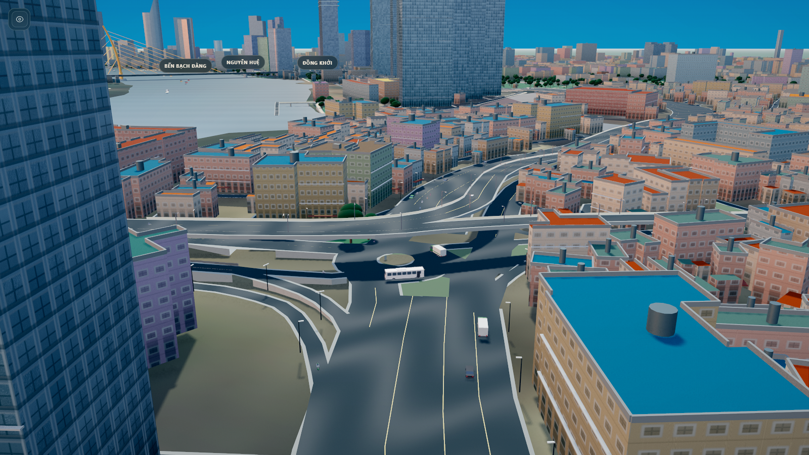 | Đã sửa | Cầu vượt có dốc dẫn theo profile (A, C). Cột đèn đặt theo mép hợp nhất, không trên lòng đường (E2). Đảo răng cưa bỏ (J-3). Xe máy có người lái (J). Cầu vượt không có trụ là thiết kế: trụ chỉ đặt trên nước. |
| 02 giao lộ nhìn từ trên | [02-giao-lo-nhin-tren.webp](research/issues-31/02-giao-lo-nhin-tren.webp) | 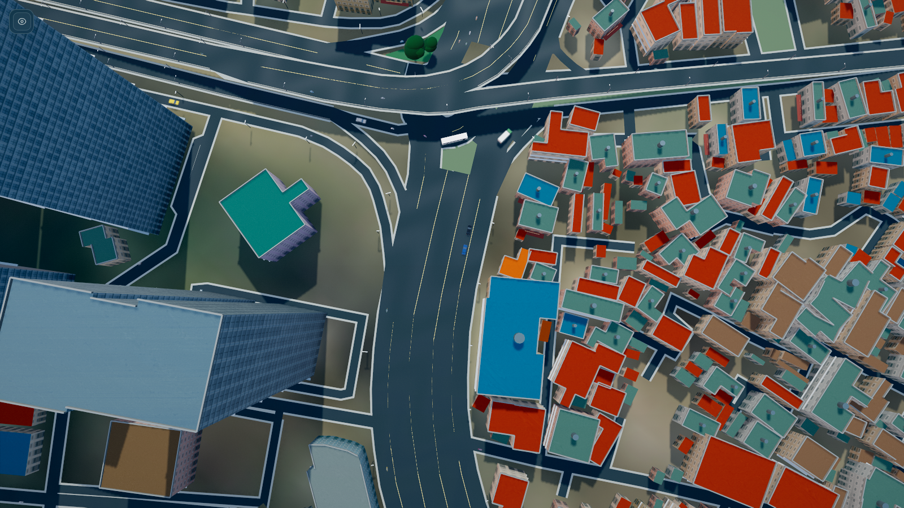 | Đã sửa, còn 1 mục nhỏ | Miter và mặt giao lộ loại chồng ribbon (B). Lấp khe đường đôi (G). Đèn không rơi trên mặt đường (E2). Còn tồn: khe sáng mảnh ở ranh polygon giao lộ trên cao, chỉ thấy ở cận cảnh (J-4, chưa rõ nguyên nhân). Thumbnail ảnh 02 không thấy z-fighting rõ, không vỡ hình. |
| 03 cầu lơ lửng xuyên nhà | [03-cau-lo-lung-xuyen-nha.webp](research/issues-31/03-cau-lo-lung-xuyen-nha.webp) | 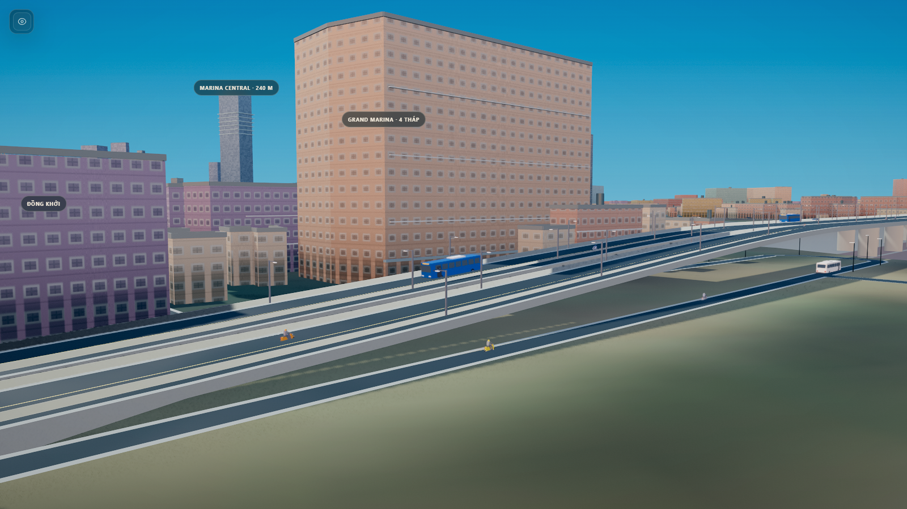 | Đã sửa, cần xác minh vệt đỏ | Bảng `bridge-corrections-31` ẩn 42 footprint xuyên mặt cầu và nâng đáy mái của 1 công trình (C). Đầu cầu dẫn nối đường (C, G). Vệt đỏ trên mái **chưa đối chiếu lại** (chưa đo). |
| 04 vạch qua đường đen | [04-vach-qua-duong-den.webp](research/issues-31/04-vach-qua-duong-den.webp) | 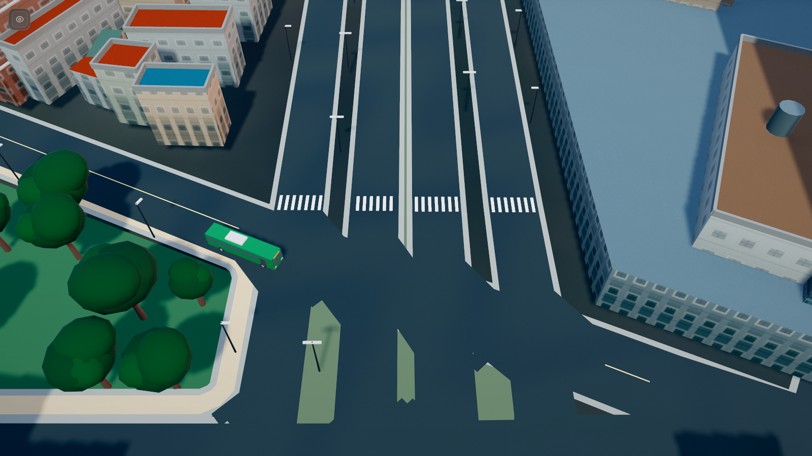 | Đã sửa | Vạch zebra `polygonOffset` trên asphalt, footway trùng lòng đường không được vẽ (E2). Đèn đặt trên dải phân cách đủ rộng và không trên vạch (E2). Vài đảo nhỏ vẫn còn mép xiên ở cận cảnh, đã giảm (J-3). |
| 05 đầu cầu Ba Son | [05-dau-cau-ba-son.webp](research/issues-31/05-dau-cau-ba-son.webp) | 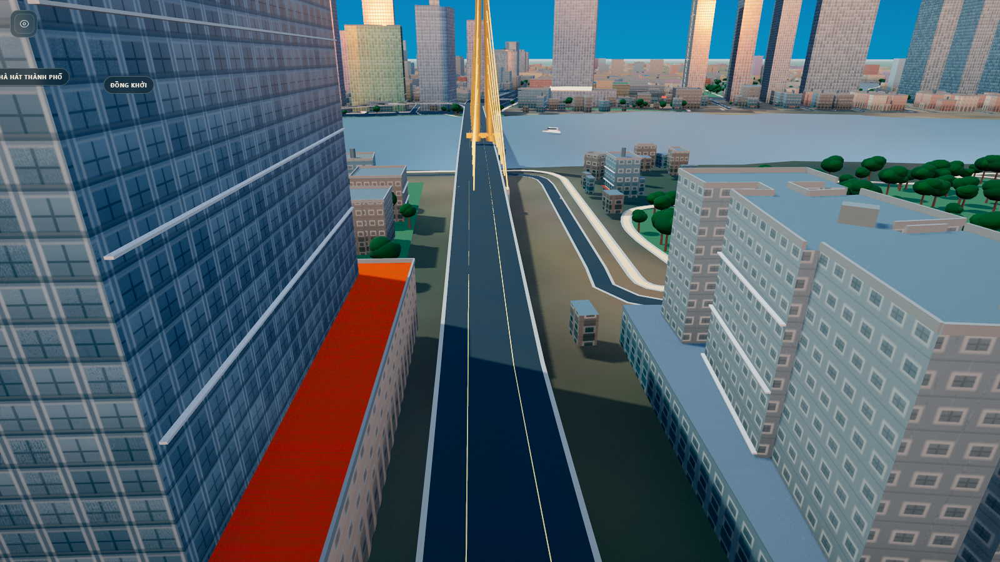 | Đã sửa | Cầu dẫn bám đỉnh profile way 321564421 và thu bề ngang theo mép hai way (C, G). Mặt đường khớp đỉnh hộp sai lệch 0,001 m. Thumbnail cho thấy đầu cầu nối liền lên cầu, tháp dây văng hiện rõ; mảng mái đỏ bên trái là **mái công trình** (cùng tông đỏ khu phố), không phải lỗi hình. Hình dạng Ba Son không đổi (signature). |

Lỗi chung "nền đất quá sáng": đã đổi nền đất tối hơn (B). Xe là hộp đơn giản: đã thay bằng mô hình có hình dạng (J).

## 6. Ảnh mật độ, sáu góc ngày/đêm và lưu lượng xe

### 6.1 Ảnh 6 góc × ngày/đêm (bản cuối, `3a3ade0`)

WebGPU, `quality=presentation`, mật độ Đầy đủ, 1600 × 900, ẩn giao diện. Thư mục `../../research/vibecode-31-release/`.

| Góc (`data-view`) | Ngày | Đêm |
|---|---|---|
| overview | 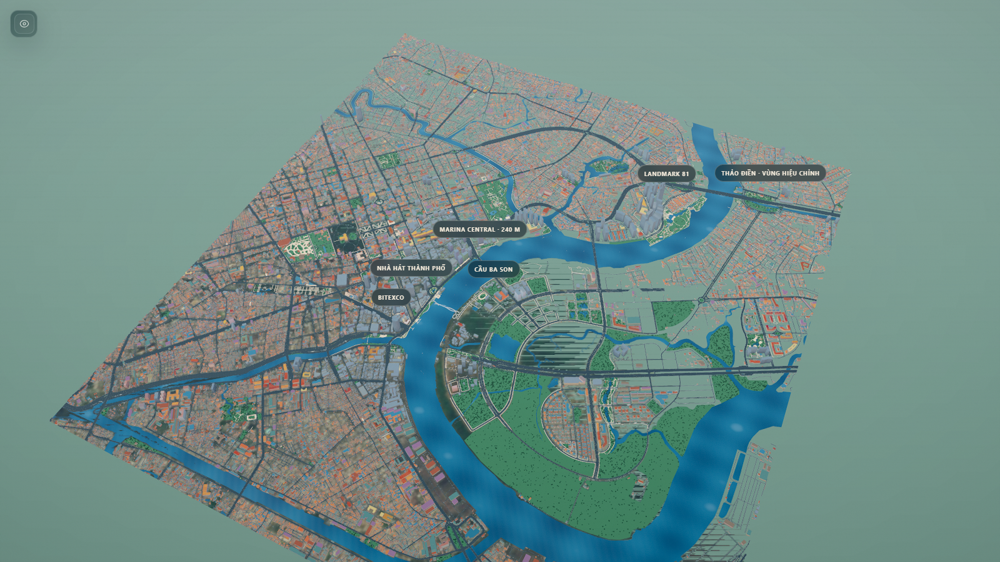 | 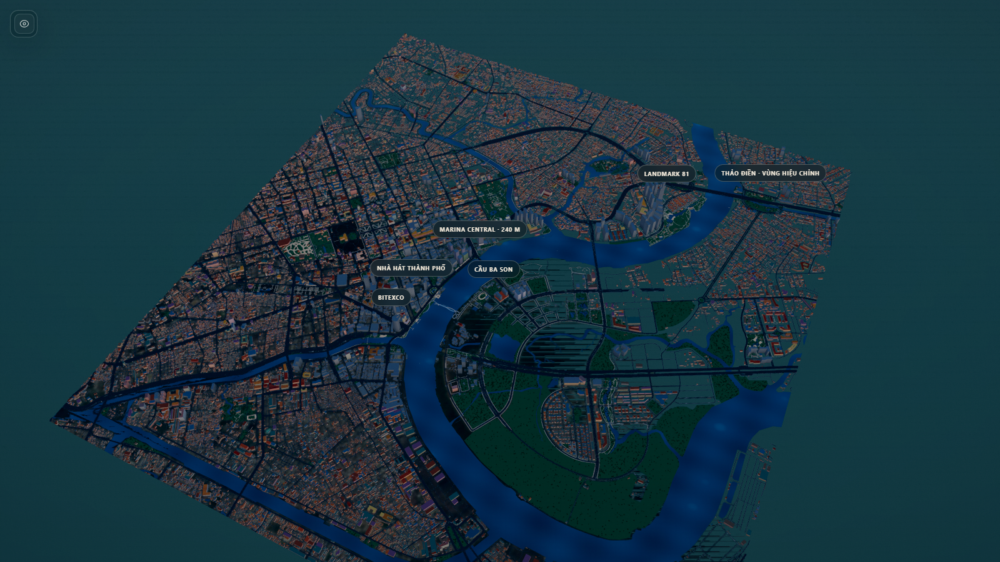 |
| bason | 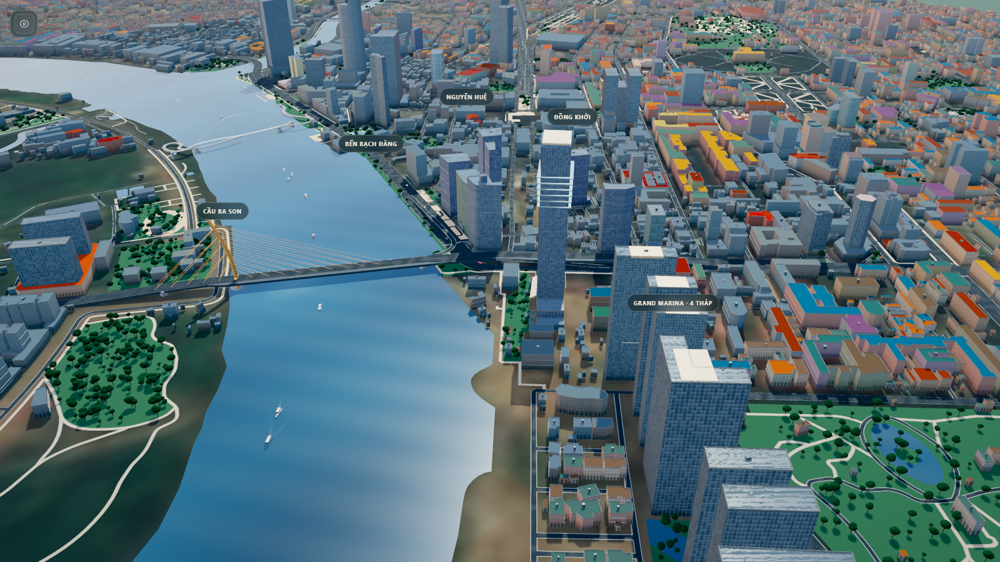 | 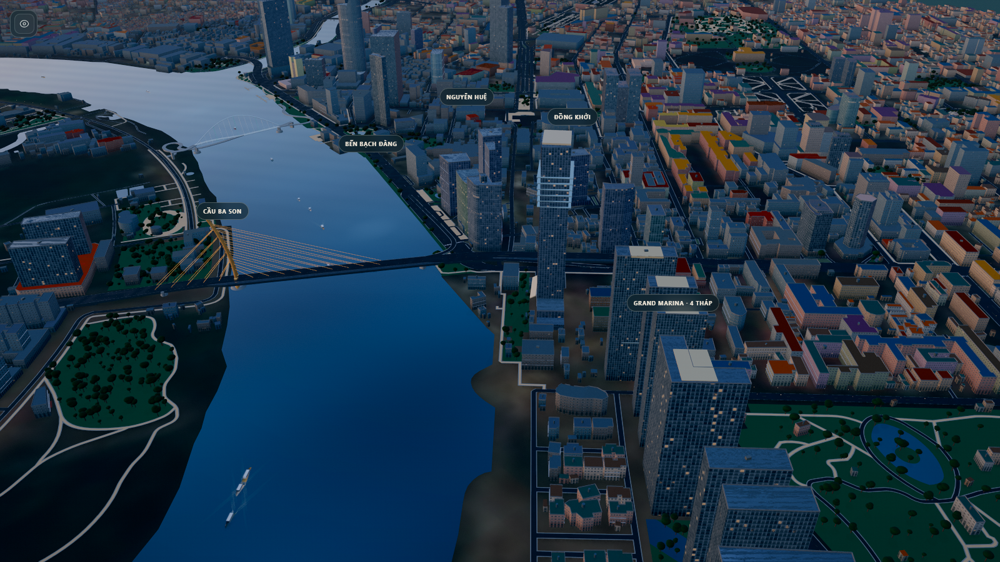 |
| boulevard | 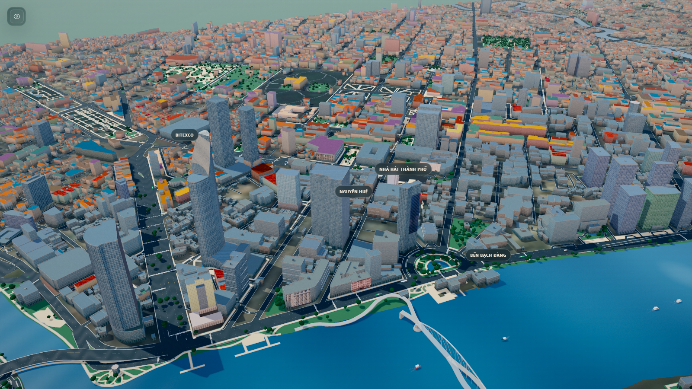 | 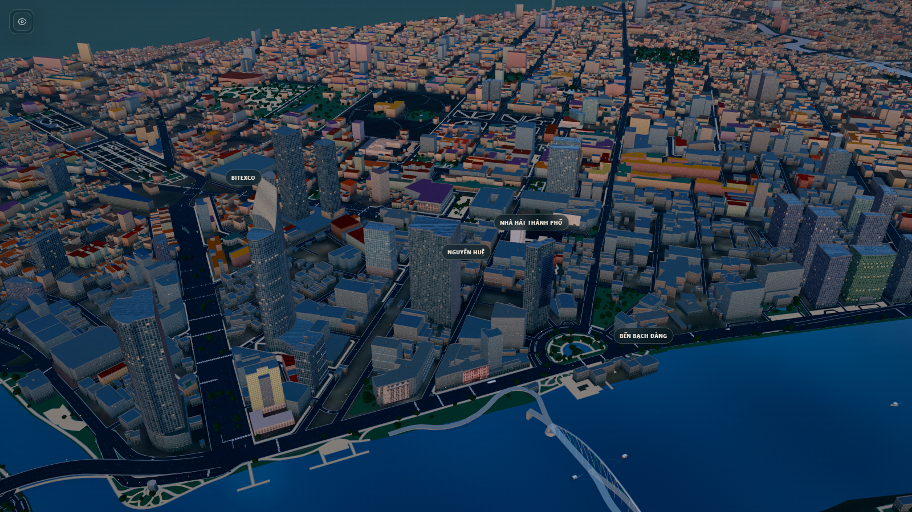 |
| corridor | 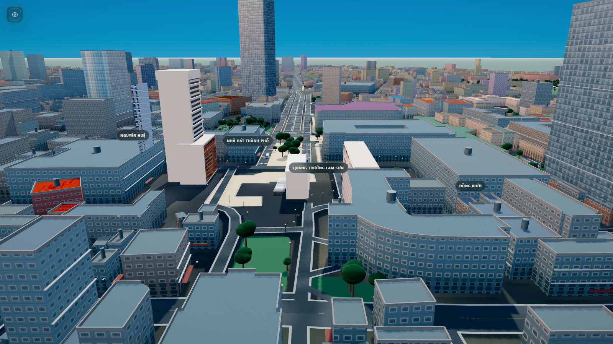 | 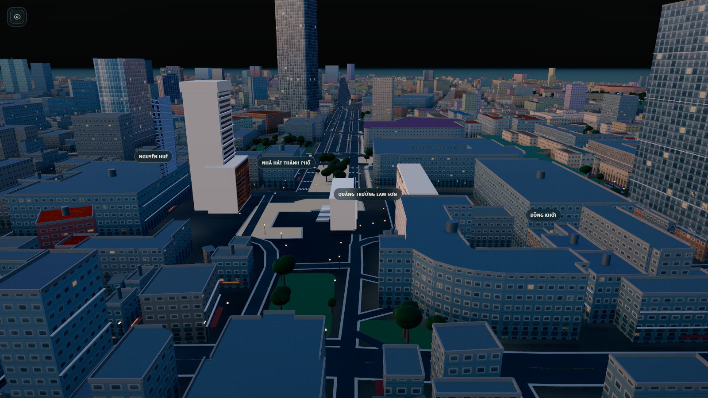 |
| river | 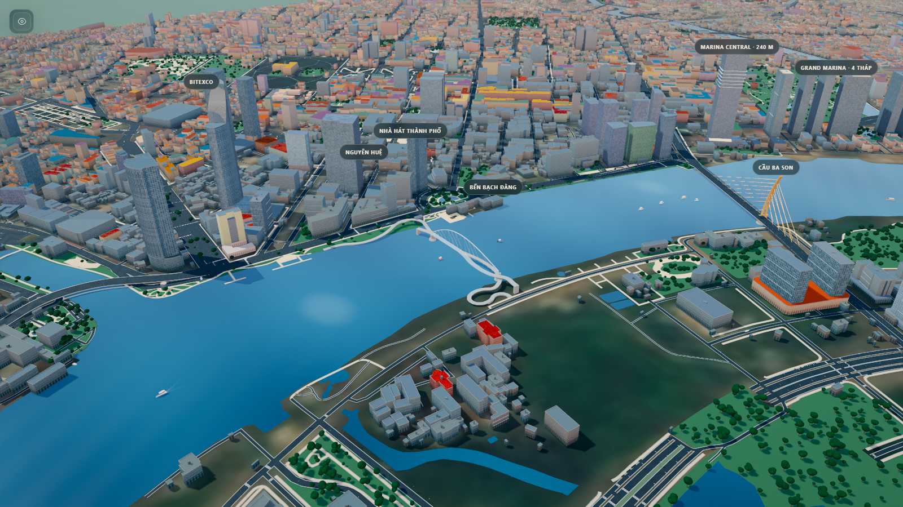 | 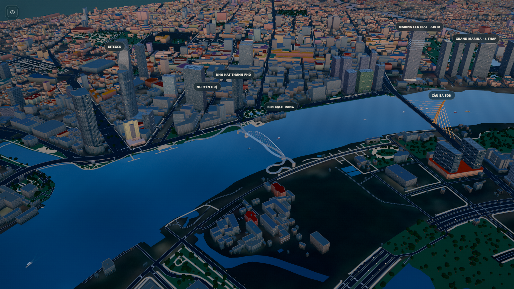 |
| materials | 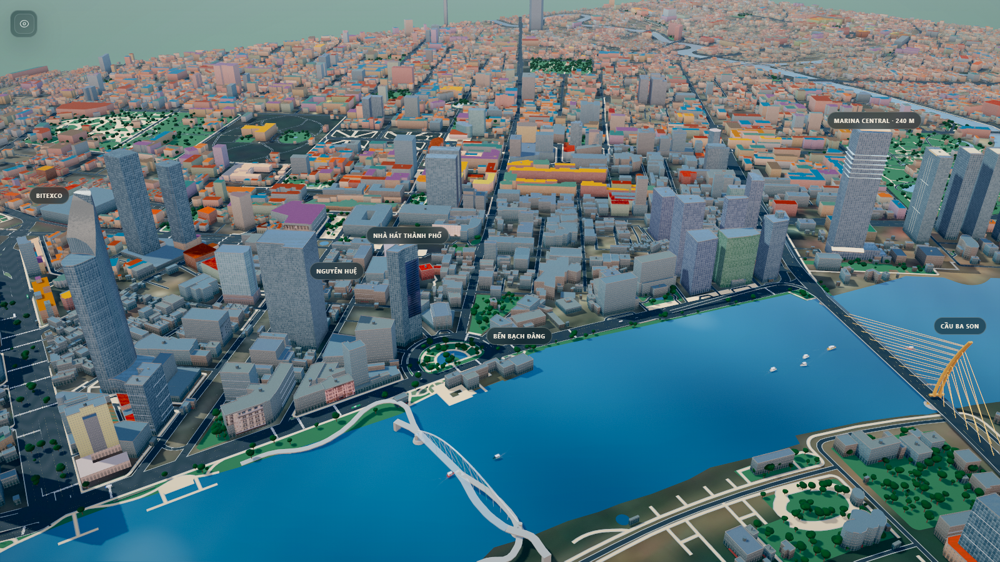 | 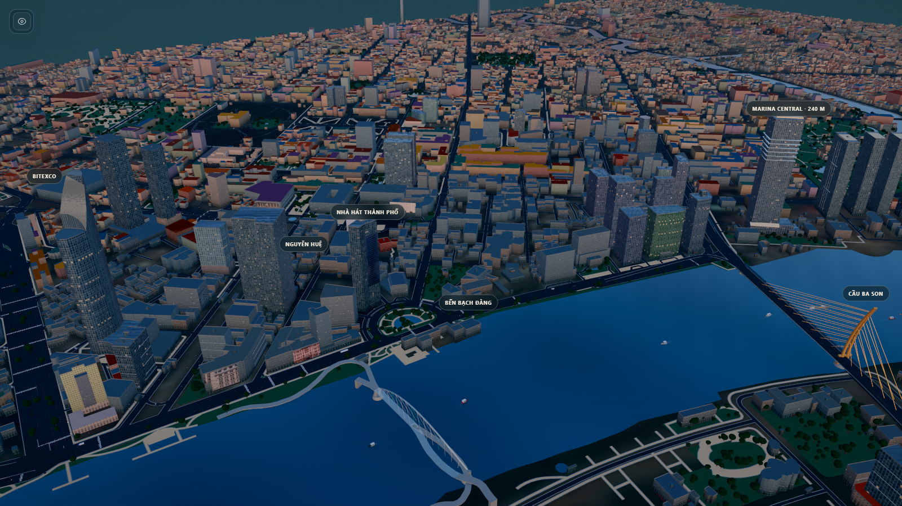 |

### 6.2 Mật độ (ảnh sau G3)

Ảnh mật độ sau G3 (WebGPU, ngày, `quality=presentation`):

| Mức | Overview | Boulevard |
|---|---|---|
| Đầy đủ | `research/vibecode-31-g3/sau-full-overview.png` | `research/vibecode-31-g3/sau-full-boulevard.png` |
| Tối thiểu | `research/vibecode-31-g3/sau-minimal-overview.png` | `research/vibecode-31-g3/sau-minimal-boulevard.png` |

Ảnh trước G3 cùng góc: `research/vibecode-31-g3/truoc-*.png`. Ảnh E/F (trước G3, bộ 24 ảnh ngày, 6 đêm, 6 WebGL 2 và 3 mobile 375 px): `../../research/vibecode-31-density/`.

## 7. Giới hạn còn lại

1. **Khe sáng mảnh ở ranh giao lộ trên cao** (J-4): chỉ thấy ở cận cảnh. Nguyên nhân chưa xác định; gối thân đường 8 cm không đổi kết quả nên đã hoàn tác.
2. **Lan can dải đôi đứt đoạn** (J-5, `truoc-cau-so14`): quy tắc `covered` gộp đoạn ≤ 40 m. Đổi quy tắc có thể làm lan can chồng lên mặt đường kề.
3. **Đèn lan can 31J không có trên Ba Son và Bạch Đằng**: cầu signature được bỏ qua để giữ hình dạng.
4. **Tỉ lệ xe chờ khoảng 12 %**, chưa đạt mục tiêu 8 %.
5. **Chồng xe hiếm trên phố hẹp hai chiều có buýt** khi sim chạy dài: 1 lần trên 600 s (`ee7a56d`), 3 lần trên sim mới. QA chưa kiểm thân xe khi chạy dài.
6. **Đổi mức lần đầu vào Tối thiểu ở góc mới**: 0,3 đến 0,4 s (three.js dựng pipeline bóng), vượt nhẹ mục tiêu 300 ms. Có thể dựng sẵn pipeline khi tải trang.
7. **Mặt đường có 9 vật liệu** (`polygonOffset` khác nhau) nên không gộp được về một mesh.
8. **FPS đo trên một máy**, màn hình 120 Hz. Chưa đo trên máy tham chiếu màn hình 60 Hz.
9. **Khu mô phỏng — hành vi xe vắt ranh:** nhờ biên 250 m, xe trên cầu/cạnh vắt ranh hiện ở **cả hai khu kề**; cạnh cần biên lớn hơn 250 m (cầu Ông Lãnh ~254 m, cầu Sài Gòn ~1 km) chỉ thuộc trọn một bên. Đường/cầu và mặt đất luôn vẽ đủ ở mọi khu (mesh gộp theo loại lớp), nên chọn khu chủ yếu giảm tam giác/fragment, ít giảm draw call.
10. **`qa-traffic-31` chập chờn** ở ca "y mặt cầu ±0,05 m" (mẫu biên ở nút chuyển tiếp profile đầu cầu): chạy lại một lần xanh 36/36, không tái lập, không sửa (theo điều phối).
11. **`work/rel-metrics.json` chưa có `traffic:*`**; `mode=traffic` chưa ghi. Số giao thông lấy từ `qa-traffic-31`.
12. **Giao thông và cầu thủ tục là minh họa:** không phản ánh lưu lượng hay kết cấu khảo sát thực; nhãn "illustrative" giữ trong `materialStatus` và chú giải UI.

## 8. Còn lại và chưa đo

- Đã điền hết chỗ `_chờ đo_`/`_đang hoàn thiện_` (H, I, `?v=31a`, số liệu cuối).
- Ảnh gốc lỗi đã có trong nhánh tại `research/issues-31/0X-*.webp` (commit `909c4f2`); bộ 17 ảnh nghiệm thu ở `../../research/vibecode-31-release/` (commit `3a3ade0`).
- **Chưa đo:** phân bổ tam giác theo nhóm ở mức Cân bằng và Tối thiểu; ảnh overview trước G3; `traffic:*` trong `rel-metrics.json`; FPS trên máy tham chiếu màn hình 60 Hz; vệt đỏ trên mái ảnh 03 (cận cảnh).
- README đã liệt kê tham số mới `&density=`, `&region=`, `&mode=` và trỏ tới `VISUAL-RUNTIME-31.md` cùng `RELEASE-QA-31A.md`.
